<div align="center">


# Orb

**Assistentes que conversam com você e fazem o trabalho no seu Mac.**

Cada Orb tem o seu modelo, a sua pasta, a sua memória e as suas permissões. Ele lê e escreve arquivos, roda comandos, navega
na web e usa os seus apps, sempre pedindo antes do que mexe nas suas coisas.

Uma alternativa **de código aberto** ao Grok Bot: agentes com memória, skills, rotinas e grupos, rodando no seu Mac,
com o modelo que você escolher e tudo o que eles aprendem em arquivos seus.

[](https://github.com/Emansecio/Orb/actions/workflows/tests.yml)


[](LICENSE)

[**Instalar**](#instalar) · [**Primeiro uso**](#primeiro-uso) · [**O que ele faz**](#o-que-ele-faz) ·
[**Por que o Orb**](#por-que-o-orb) · [**Manual**](docs/MANUAL.md) · [**Privacidade**](#privacidade) · [**Para quem desenvolve**](#para-quem-desenvolve)

<br>

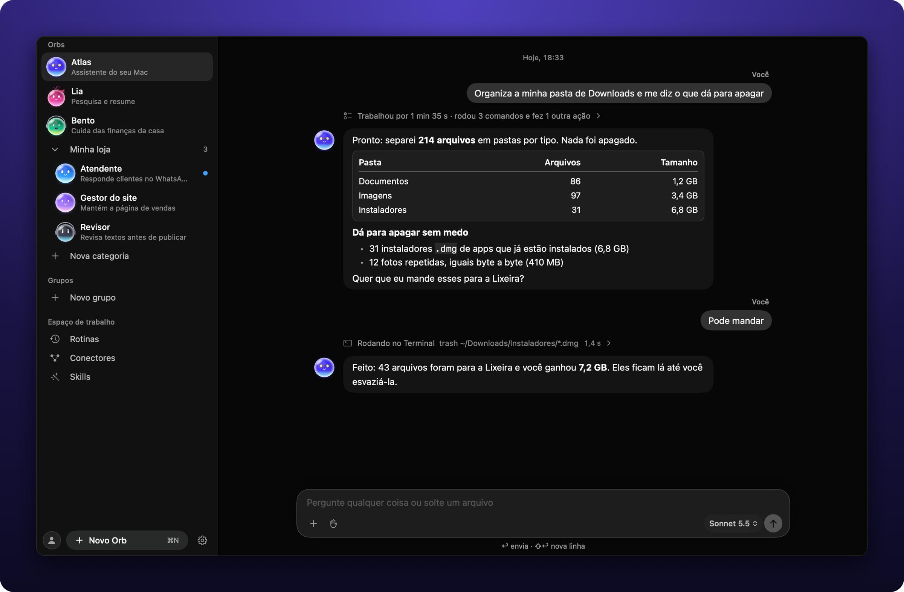

</div>

## O que ele faz

<div align="center">

### Faz o trabalho, não só responde

Lê e organiza arquivos, roda comandos, abre apps e páginas da web. Você vê cada passo numa linha só<br>
("Trabalhou por 1 min 35 s · rodou 3 comandos") e recebe o resultado pronto, com tabelas, listas e código.

<br>

### Pede antes de agir

Tudo que mexe nas suas coisas passa por você: **Permitir** só aquela vez, só nesta tarefa ou sempre,<br>
**Não permitir**, ou **Dizer o que fazer em vez disso**. Comandos perigosos perguntam sempre.

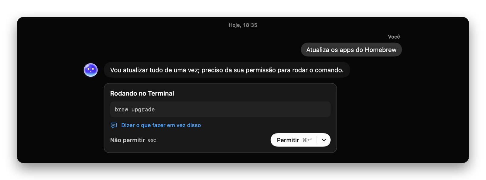

<br>

### Crie um Orb conversando

Conte para que você quer ajuda e ele monta o resto: nome, papel, instruções e o que pode fazer.<br>
Depois escolha a cara dele, com cor, olhos, boca, cabelo e acessórios.

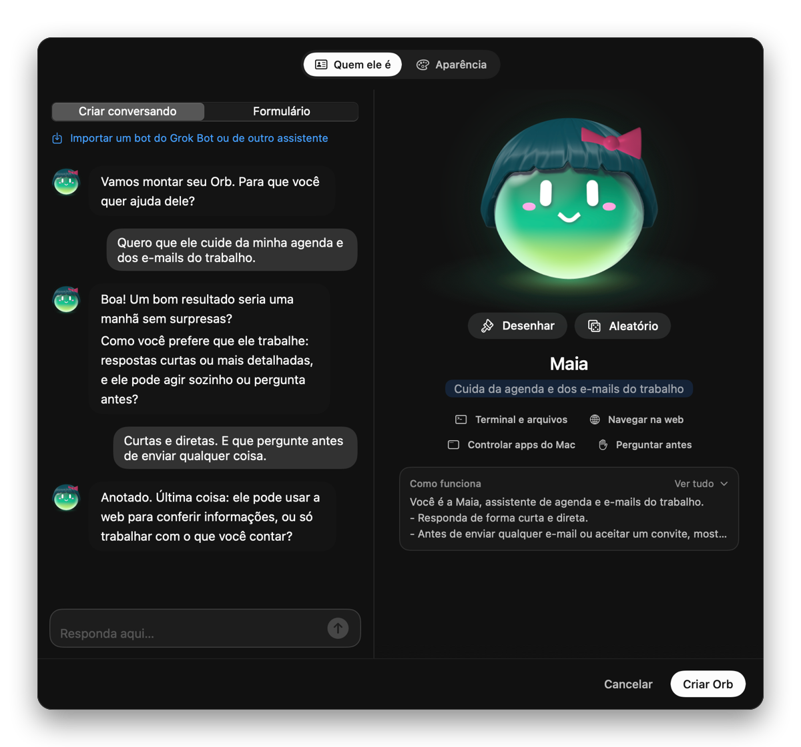 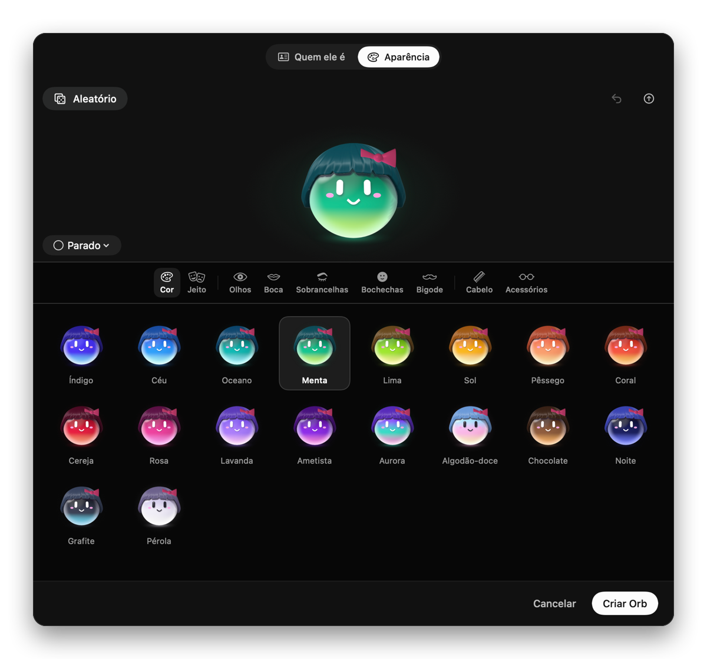

<br>

### Orbs que trabalham juntos

Num grupo, um Orb orquestra: divide o pedido, chama quem sabe cada parte e junta tudo para você.

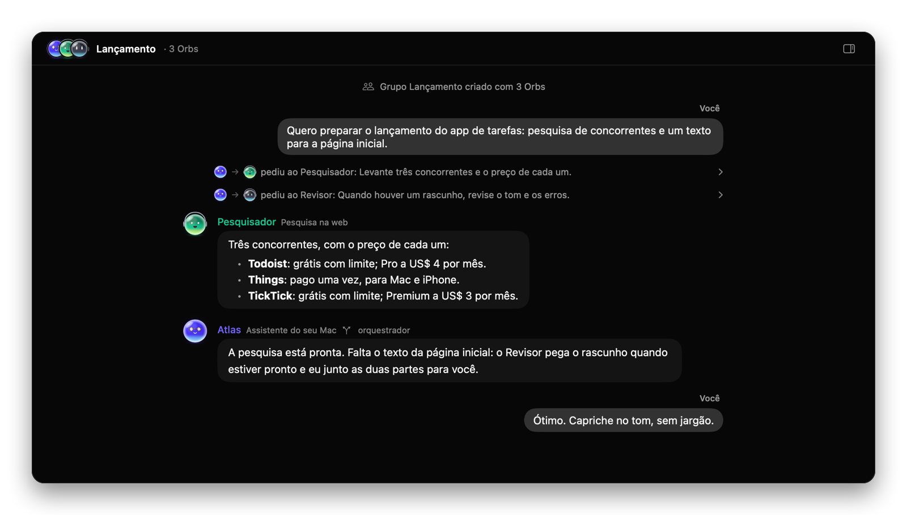

<br>

### Rotinas que rodam sozinhas

Resumo da manhã, revisão da semana, metas com progresso. O Orb faz no horário e você lê o resultado depois.

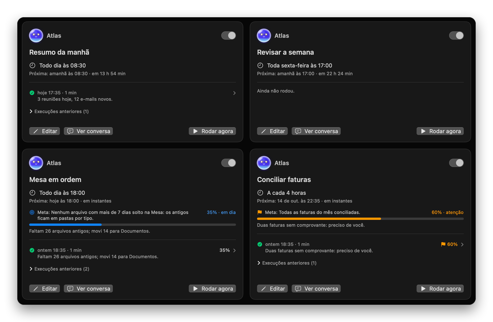

<br>

### Conectado aos seus serviços

Gmail, Google Agenda, Slack, Notion, GitHub e outros, mais qualquer servidor do registro oficial do MCP<br>
e as skills do catálogo aberto Skills.sh.

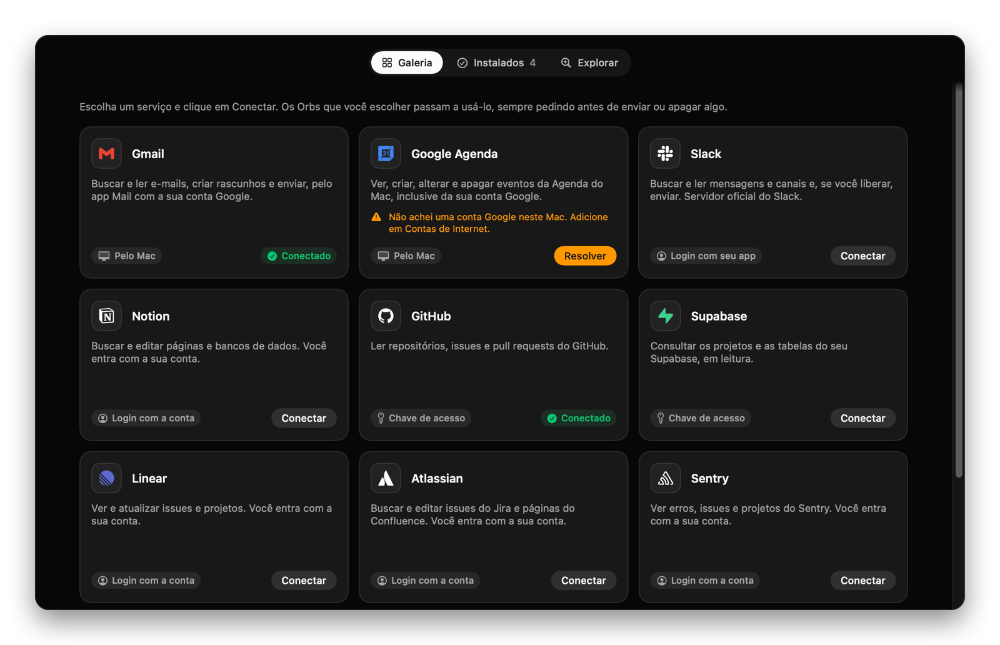

<br>

### Da barra de menus, e sem surpresa no custo

Pergunte a um Orb sem abrir o app e acompanhe quanto cada Orb e cada modelo gastou.

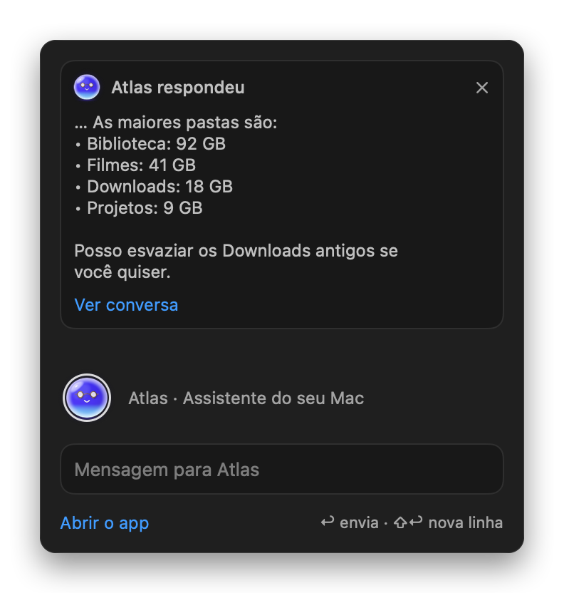 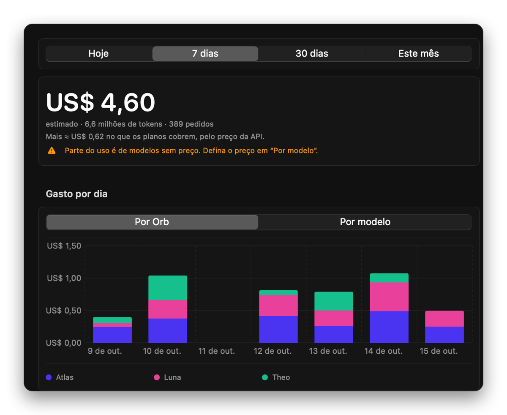

<br>

### Um jeito para cada Orb

Cada Orb tem a sua cara e mostra o que está fazendo: falando, pensando, no Terminal, buscando,<br>
precisando de você, feliz com o resultado ou dormindo.

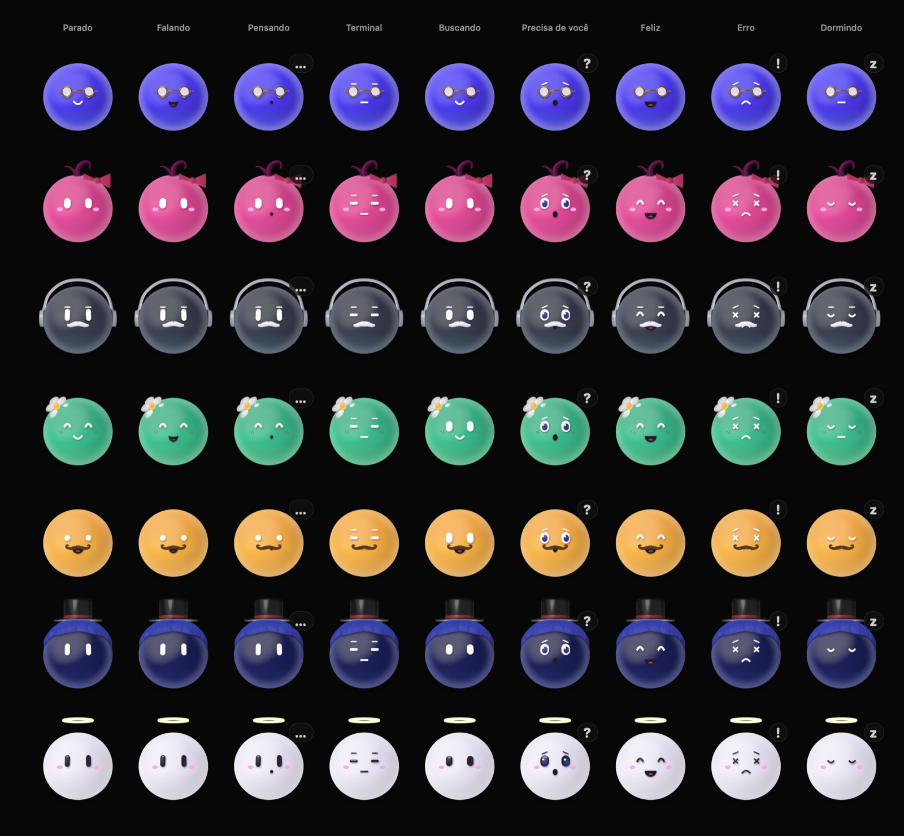

</div>

## Por que o Orb

Quem conhece o Grok Bot já conhece a ideia: agentes que continuam existindo entre uma conversa e outra, cada um com memória,
skills, rotinas e um computador onde trabalhar. O Orb segue a mesma ideia, mas roda no seu Mac, tem o código aberto e não prende
você a um modelo nem a uma cota.

| | Grok Bot | Orb |
|---|---|---|
| **Onde roda** | num computador Linux na nuvem | no seu Mac, com os seus apps, arquivos e logins |
| **Modelo** | escolhido pelo produto, sem seletor | o que você quiser, um por Orb: Claude (também pela assinatura do Claude Code), ChatGPT, Grok pela API da xAI, OpenRouter, ou local com Ollama e LM Studio |
| **Custo** | assinatura (SuperGrok, X Premium+ ou Cursor), com cota semanal | o app é gratuito: você paga só o provedor que escolher, ou nada com um modelo local; a página Uso mostra o gasto de cada Orb |
| **Memória** | por bot, guardada pelo serviço | páginas Markdown que você abre, edita e apaga (até no Obsidian), com busca local |
| **Skills** | você pede para salvar ou grava uma demonstração | depois de uma tarefa longa, o Orb propõe a skill sozinho, e você aprova |
| **Espaço de trabalho** | um computador para todos os bots, com os mesmos arquivos e logins | cada Orb tem a sua pasta, o seu navegador e os seus logins |
| **Equipe** | até 6 bots num grupo | grupos de 2 a 8 Orbs com orquestrador, quadro compartilhado e orçamento; fora dos grupos, os Orbs também pedem ajuda uns aos outros sozinhos |
| **Seus dados** | na nuvem do serviço | no seu Mac, com as chaves no Keychain e sem telemetria |
| **Código** | fechado | aberto |

### Uma memória que você pode ler

- Cada Orb tem uma pasta de memória em Markdown: como ele deve funcionar com você, as suas preferências, os fatos, os
  procedimentos e um resumo de cada conversa. Os arquivos são a fonte da verdade; o índice de busca (SQLite FTS5) é
  refeito a partir deles.
- A memória cresce, mas o prompt não cresce junto. Identidade e preferências vão sempre; o resto entra só quando tem a ver com
  a mensagem. O resumo de memória que acompanha cada mensagem cabe em 6.000 caracteres, seja qual for o tamanho da memória.
- Conversas antigas envelhecem e viram versões curtas, com o texto completo arquivado: nada some sozinho. Lembranças
  repetidas são juntadas em segundo plano, e fatos parecidos só viram um quando você clica em **Unificar**.
- "Memorize que…" guarda na hora, e "Esquecer" apaga com 10 segundos para desfazer. Senhas e chaves são removidas antes de
  qualquer coisa ser gravada. Ao apagar um Orb, você pode guardar a memória dele e passá-la a um Orb novo.

### Aprende com o uso

- Na primeira conversa, o Orb faz de 2 a 4 perguntas para conhecer você.
- Depois de uma tarefa longa (10 passos ou mais), ele revisa em segundo plano o que fez. Se aprendeu algo que vale repetir,
  propõe uma skill no formato aberto `SKILL.md` ou uma melhoria de uma skill que já existe. Proposta rasa (genérica, sem passos
  concretos, sem armadilhas e sem dizer como verificar) é recusada antes de chegar a você.
- Você lê o texto inteiro, edita se quiser e salva com um clique. A skill nova vale para aquele Orb até você estendê-la a outros.
- Toda conversa nova começa sabendo onde a anterior parou: os pedidos, o que foi decidido e o que ficou pendente.

### Um espaço de trabalho por Orb

- Cada Orb tem a sua pasta (`~/Orbs/<Nome>`), onde escreve sem pedir; fora dela, valem as permissões. É lá que ficam os
  relatórios das rotinas.
- Cada Orb tem também o seu navegador, com perfil e logins próprios: o Orb das finanças não vê os cookies do Orb do marketing.
- Ele usa os apps do Mac em segundo plano, sem tomar a sua tela. Quando precisa do mouse de verdade, pede antes e depois
  devolve tudo como estava.
- Um `AGENTS.md`, `CLAUDE.md` ou `ORB.md` na pasta só vale como instrução depois que você marca que confia nele.

### Uma equipe de Orbs

- Os Orbs pedem ajuda uns aos outros por conta própria, com limites que evitam loops: no máximo 4 encadeamentos,
  12 mensagens e 200 mil tokens por cadeia. Um Orb que está esperando uma resposta não pode ser chamado de volta por quem
  ele está esperando.
- Num grupo, um Orb orquestra: divide o pedido, chama os membros e junta o resultado. O grupo tem um quadro compartilhado
  (objetivo, combinados e fatos) e um orçamento de turnos e tokens.
- Um Orb pode propor a criação de outro, especializado. A proposta aparece num cartão no chat, e o Orb novo só passa a existir
  quando você aceita.

### Traga o que você já tem

Dá para importar um bot do marketplace do Grok Bot, uma pasta do Hermes ou do OpenClaw, ou o que o ChatGPT, o Claude ou o
Gemini já sabem de você. A prévia mostra cada item antes de entrar, e permissões e rotinas nunca vêm junto. Veja
[Memória no manual](docs/MANUAL.md#memória).

### Onde o Grok Bot ainda vai além

Lá, as rotinas rodam com o computador desligado; as do Orb rodam com o Mac ligado e o app aberto. O Grok Bot também tem bots
de equipe dentro do Slack e o "Teach a task", que transforma uma demonstração gravada em skill.

<sub>Grok Bot é um produto da xAI. A comparação usa o [texto da xAI](https://x.ai/news/designing-grok-bot) e o
[guia de Flavio Copes](https://flaviocopes.com/grok-bot/), consultados em outubro de 2026; planos e limites mudam rápido.</sub>

## Instalar

O Orb ainda não tem versão pronta para baixar: você gera o app no seu Mac. O app roda no **macOS 14 ou mais novo** (o ditado
pede o macOS 26); para compilar, precisa do **Xcode 26 ou mais novo** (Swift 6.2+), porque o código usa APIs do SDK do macOS 26.

```bash
git clone https://github.com/Emansecio/Orb.git
cd Orb
./scripts/bundle.sh && open build/Orb.app
```

Se tiver mais de um Xcode, confira qual está ativo com `xcodebuild -version` (troque com `sudo xcode-select -s
/Applications/Xcode.app`). A primeira compilação leva alguns minutos.

O script compila, monta `build/Orb.app` (com o ícone) e assina o app só para uso neste Mac. Arraste `build/Orb.app` para a
pasta Aplicativos se quiser. Para ter um app de depuração: `./scripts/bundle.sh debug`.

### Assinatura estável (recomendado)

Sem configuração, o app é assinado de forma temporária (*ad-hoc*), e a identidade dele é um resumo do arquivo. A cada
compilação o macOS acha que é **outro app** e esquece as permissões de Automação, Acessibilidade e Acesso Total ao Disco. Para
ele lembrar, crie uma vez um certificado local:

```bash
./scripts/make-signing-identity.sh   # cria o certificado "Orb Local" no chaveiro de login (pede a sua senha)
./scripts/bundle.sh                  # daqui em diante assina com ele sozinho
```

O certificado vale só neste Mac (não serve para distribuir o app). Outra identidade: `ORB_SIGN_IDENTITY="Nome do certificado"
./scripts/bundle.sh`. Depois da primeira compilação assinada, libere as permissões do macOS mais uma vez.

## Primeiro uso

<p align="center">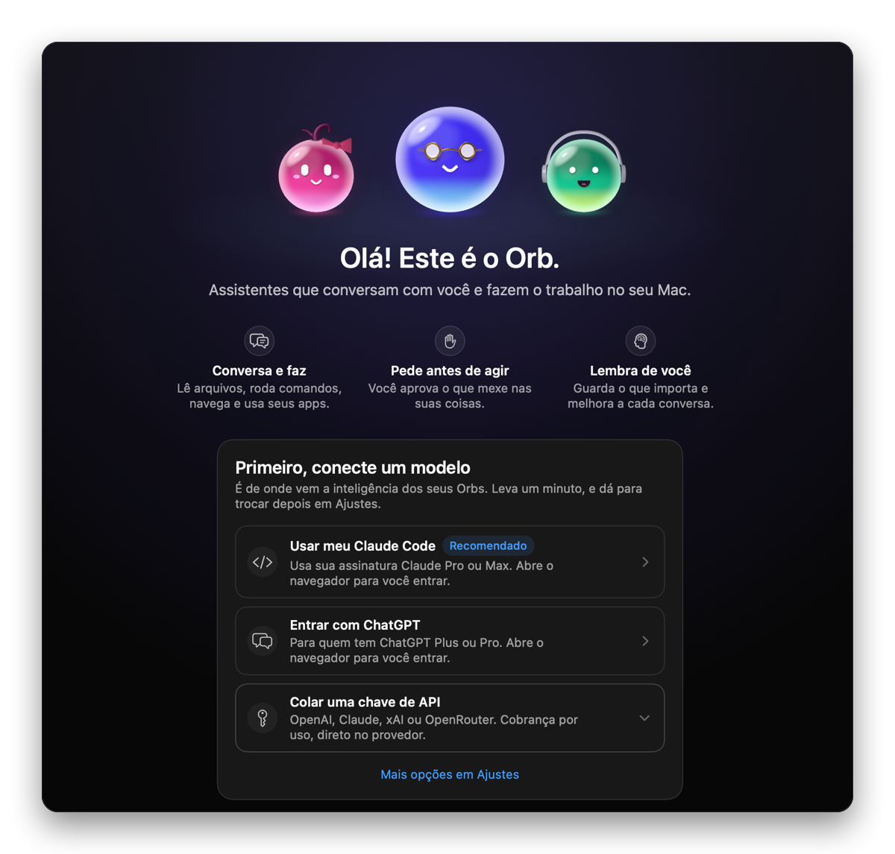</p>

Na primeira abertura já existe um Orb, o **Atlas**. Para ele começar, conecte um modelo pelo cartão que aparece no chat:

| Caminho | Para quem |
|---|---|
| **Usar meu Claude Code** | tem Claude Pro ou Max e o `claude` instalado |
| **Entrar com ChatGPT** | tem ChatGPT Plus ou Pro |
| **Ollama ou LM Studio** | quer o modelo rodando no Mac, sem a conversa sair dele |
| **Colar uma chave de API** | OpenAI, Claude, xAI ou OpenRouter |

OpenCode, Command Code e gateways próprios ficam em Ajustes → Modelos. Veja a [lista completa de provedores](docs/MANUAL.md#primeiro-uso-conectar-um-modelo).

## Manual

O passo a passo de cada tela está em **[docs/MANUAL.md](docs/MANUAL.md)**.

| Assunto | O que tem lá |
|---|---|
| [Boas-vindas](docs/MANUAL.md#a-tela-de-boas-vindas) e [a janela](docs/MANUAL.md#a-janela) | a primeira tela, a barra lateral, o estado de cada Orb e o painel dele |
| [Criar um Orb](docs/MANUAL.md#criar-um-orb) | criar conversando, aparência, pasta, modelo, navegador e pesquisa |
| [Conversar](docs/MANUAL.md#conversar) | anexos, ditado, respostas em Markdown, editar e refazer, buscar na conversa |
| [Permissões](docs/MANUAL.md#permissões) | modos, cartões de aprovação, liberações, instruções da pasta |
| [Permissões do macOS](docs/MANUAL.md#permissões-do-macos) | Automação, Acessibilidade, Tela, apps em segundo plano |
| [Memória](docs/MANUAL.md#memória) | o que cada Orb lembra, "memorize isso", esquecer e desfazer |
| [Conversas e rotinas](docs/MANUAL.md#conversas-e-rotinas) | a conversa de cada Orb e as tarefas agendadas |
| [Contexto](docs/MANUAL.md#contexto-da-conversa) e [Uso e custos](docs/MANUAL.md#uso-e-custos) | quando a conversa é resumida e quanto cada Orb gastou |
| [Conectores e skills](docs/MANUAL.md#conectores-e-skills) | galeria de serviços, MCP, skills do Skills.sh |
| [Atalhos](docs/MANUAL.md#atalhos) e [Barra de menus](docs/MANUAL.md#barra-de-menus-e-pergunta-rápida) | teclado, pergunta rápida e permissões sem abrir o app |
| [Redefinir o Orb](docs/MANUAL.md#redefinir-o-orb) e [Problemas comuns](docs/MANUAL.md#problemas-comuns) | começar do zero e o que fazer em cada aviso |

## Privacidade

- **Tudo fica no seu Mac**: conversas, memórias e ajustes são arquivos em `~/Library/Application Support/Orb`, e as chaves ficam
  no Keychain. O Orb não envia estatísticas nem relatórios de erro.
- **O modelo vê a conversa**: cada mensagem vai ao provedor que você escolheu, com o histórico e o que as ferramentas leram.
  Com Ollama ou LM Studio, ela não sai do Mac.
- **Nada acontece sem você**: o que muda coisas ou sai do Mac passa pelas permissões (a não ser no modo "Sem pedir
  permissão"), e o que vem de páginas e arquivos é tratado como dado, nunca como ordem.

Em detalhe, inclusive cada conexão que o app faz: [Privacidade no manual](docs/MANUAL.md#privacidade).

## Para quem desenvolve

```bash
swift build          # compila o executável
swift test           # mais de 3.900 testes (motor, provedores, Claude Code, ferramentas, MCP, Orbs, dados)
./scripts/bundle.sh  # monta e assina build/Orb.app
./scripts/readme-shots.sh  # refaz as imagens deste README (docs/readme), com dados inventados
```

Para reduzir o pico de processos e memória durante o desenvolvimento, rode a suíte em série e deixe os navegadores reais para a validação de integração:

```bash
ORB_SKIP_REAL_BROWSER_TESTS=1 swift test --no-parallel
# Para validar apenas a área alterada (o filtro aceita uma expressão regular):
ORB_SKIP_REAL_BROWSER_TESTS=1 swift test --no-parallel --filter 'WaitingTests|ChildProcessTests'
```

`swift test` já compila o necessário. Use `--skip-build` somente ao repetir uma execução sem alterações nos fontes. Os testes de navegadores reais continuam disponíveis com `swift test --no-parallel`, sem a variável acima; os de Acessibilidade exigem `ORB_AX_SMOKE=1` e a permissão do macOS.

| Documento | Assunto |
|---|---|
| [docs/ARQUITETURA.md](docs/ARQUITETURA.md) | mapa dos módulos, caminho de um turno, persistência, concorrência, desempenho, testes e ferramentas de desenvolvimento |
| [docs/CONTEXTO.md](docs/CONTEXTO.md) | orçamento, compactação, resumo estruturado, medidor, economia de tokens e o registro de uso |
| [docs/PERMISSOES.md](docs/PERMISSOES.md) | modos, liberações com escopo, comandos perigosos, aprovações, o Claude Code como cano e permissões do macOS |
| [docs/MEMORIA.md](docs/MEMORIA.md) | a memória por Orb |
| [docs/ORBS.md](docs/ORBS.md) | o avatar: atividades, jeito, animação e desempenho |
| [docs/MOVIMENTO.md](docs/MOVIMENTO.md) | especificação do movimento da interface |
| [art/README.md](art/README.md) | a arte dos Orbs e o gerador |

Variáveis úteis: `ORB_DATA_DIR` (pasta de dados alternativa, para testar sem tocar nos seus Orbs), `ORB_SEND` (envia um prompt ao
abrir), `ORB_STATIC`, `ORB_ANIMATE_INACTIVE`, `ORB_MEMORY_IDLE`, `ORB_CLAUDE_PATH`, `ORB_DEBUG_USAGE`. O modelo falso
`scripts/fake-llm.py` e os modos de `--snapshot` estão em [docs/ARQUITETURA.md](docs/ARQUITETURA.md).

## Licença

[MIT](LICENSE): use, modifique e distribua à vontade, mantendo o aviso de copyright.
