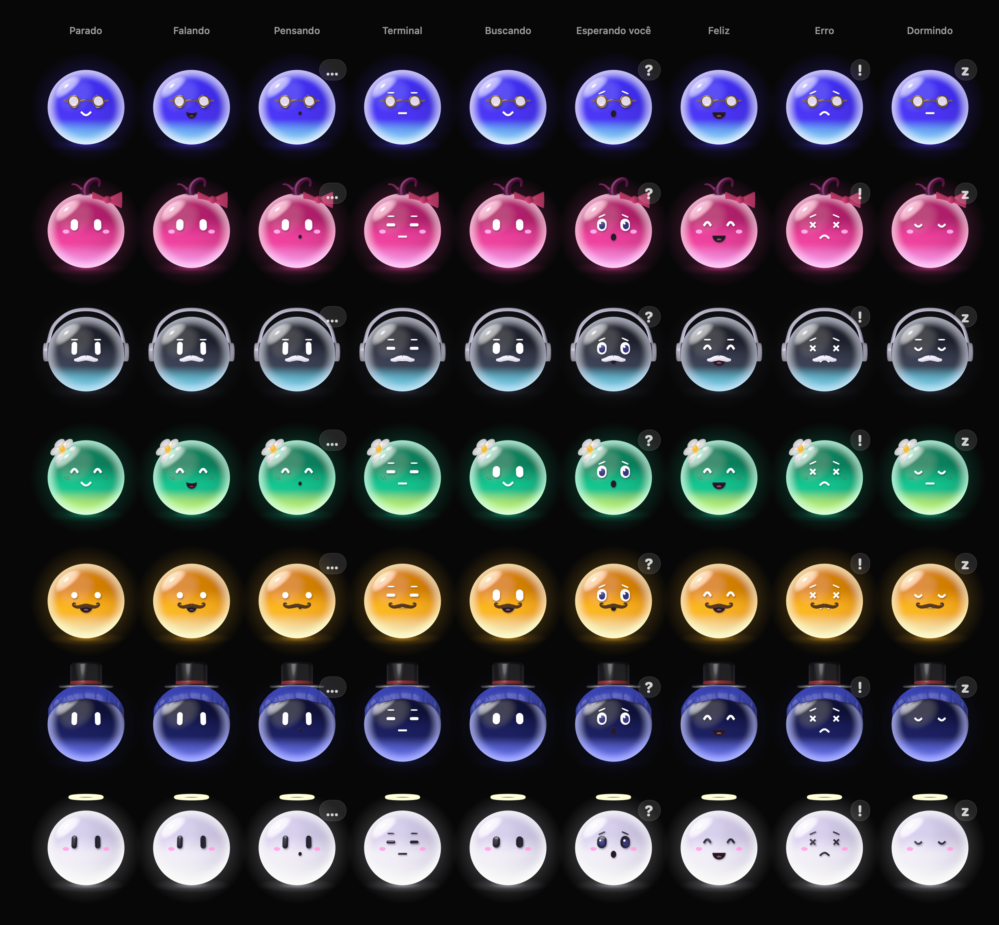

# Orbs

No app Orb, cada assistente é um **Orb**: uma esfera de gel translúcido e brilhante, iluminada como um objeto
3D macio (luz do alto à esquerda, reflexo de janela, aro fosco, brilho que sai pela base) e animada ao vivo no
app. Todos os Orbs têm o mesmo formato redondo; a identidade vem da cor, do rosto, do cabelo e dos acessórios.

Este documento cobre o lado do app: opções, atividades, jeito, movimento, onde os Orbs aparecem e o sistema de animação
(desempenho incluído). **A arte e o gerador estão descritos em [art/README.md](../art/README.md)**; é lá que se vê como as
camadas são feitas e como acrescentar uma opção nova.



---

## 1. Como o app usa a arte

```
art/orbs.py + art/orbkit/          Blender 5.2: traços planos (olhos, bocas, sobrancelhas, bigodes,
        │  orbs.py layers          visemas, acessórios) -> art/orbgen/flat
        ▼
art/orbgen (Swift, CPU)            orbgen all: corpo iluminado (18 cores), cabelos por campos de distância
        │                          (+ -brilho e -chapeu), traços assentados com sombra de contato, options.json
        ▼
Sources/Orb/Resources/Orbs/     PNGs de 640 px em camadas (corpo, traços, cabelo, acessórios, visemas) + options.json (~4 MB)
        │  scripts/bundle.sh copia para Orb.app/Contents/Resources/Orbs
        ▼
OrbCatalog / OrbImages          lê options.json; decodifica, reduz e tinge as camadas (cache limitado), fora da thread principal
        │
        ├─ OrbFrame (Canvas)                        Orb estático: listas, miniaturas, ImageRenderer
        └─ AnimatedOrb → OrbAnimationView           Orb vivo: Core Animation, passos dados por um OrbDriver por tela
                                                    (um CADisplayLink compartilhado por todos os Orbs da tela)
```

O 3D é pré-renderizado. O app só **compõe camadas** (corpo + traços do rosto + cabelo + acessórios) e as anima com
transformações 2D. Assim fica leve e com qualidade de render. Toda a luz (reflexo, sombra de forma, sombra do cabelo na
testa, sombra de contato dos traços) já vem nas imagens: nada é desenhado por quadro. `OrbCatalog` procura `Orbs/`
primeiro no pacote do app e, sem ele (`swift run`, testes), na árvore de fontes (`Sources/Orb/Resources/Orbs`).

## 2. Opções de personalização

Os ids e rótulos vêm de `options.json` (gerado junto com as imagens); a tabela é o que existe hoje.

| Categoria | Qtde | Ids |
|---|---|---|
| Cor (`color`) | 18 | indigo, ceu, oceano, menta, lima, sol, pessego, coral, cereja, rosa, lavanda, ametista, aurora, algodao, chocolate, noite, grafite, perola |
| Olhos (`eyes`) | 12 | pilulas, pontos, ovais, grandes, fendas, felizes, sono, piscadela, estrelas, coracoes, tontos, bravos |
| Boca (`mouth`) | 10 | nenhuma, sorriso, sorrisao, surpresa, neutra, gatinho, lingua, dentinho, triste, assobio |
| Visemas (`visemes`, só para falar) | 4 | fala-a (aberta), fala-o (redonda), fala-e (larga), fala-m (fechada) |
| Sobrancelhas (`brows`) | 5 | nenhuma, retas, arqueadas, bravas, preocupadas |
| Bochechas (`cheeks`) | 4 | nenhuma, blush, sardas, coracoes |
| Bigode (`mustache`) | 6 | nenhum, classico, enrolado, fino, chevron, cavanhaque |
| Cabelo (`hair`) | 13 | nenhum, franja, ondulado, cachos, black-power, coque, rabo-de-cavalo, chiquinhas, topete, espetado, moicano, tufinho, antena |
| Acessórios (`accessories`, vários) | 15 | oculos-redondos, oculos-quadrados, oculos-sol, monoculo, chapeu-festa, bone, gorro, cartola, coroa, laco, fones, aureola, chifres, orelhas-gato, flor |
| Jeito (`temperament`) | 5 | calmo, equilibrado, animado, timido, curioso (ver 3a) |

Cores livres (sRGB) para **cabelo**, **bigode** e **acessórios tingíveis** (boné, gorro, laço,
fones, chifres, flor, orelhas de gato). `nil` = cor automática: o cabelo usa a cor desenhada para a paleta
(`"hair"` em cada cor do options.json; um tom mais fundo do corpo que ainda aparece no fundo escuro), o bigode
acompanha a cor de cabelo escolhida (senão é branco, e da cor do cabelo nos corpos claros: `OrbPalette.isPale`, branco
com contraste abaixo de 2,2:1 sobre o corpo, uma linha longe de todas as paletas, entre menta 2,35 e pêssego 2,08), os
fones são brancos, as orelhas de gato têm a cor do corpo sobre cabelo (senão a do cabelo) e cada outro acessório
tem o seu padrão. **Orbs salvos antes disso não mudam de cor:** `OrbConfig.autoColors` é `.original` para um
visual sem essa chave (cabelo em tom escuro do `deep`, bigode branco, orelhas no `deep`) e `.designed` para os
novos; só os fones ficaram brancos para todos (os escuros sumiam no fundo). Atenção: uma versão anterior do app que
regravar o estado não conhece a chave e a descarta, então esses Orbs voltam às cores `.original` (nada se perde além
disso; escolher uma cor no editor fixa a cor de vez).
O editor oferece cores com nome (`OrbSwatch`: Preto, Castanho, Ruivo, Loiro, Platinado… e algumas divertidas).

**Cabelo em duas camadas.** `hair/<id>` é branco e sombreado (luz, oclusão, textura de fios) e o app o multiplica
pela cor; `hair/<id>-brilho` vem por cima sem tinta: a faixa de brilho dos fios, o aro de luz, elásticos e a
sombra que o cabelo faz na testa. As duas são camadas soltas (balançam juntas). **Chapéus:** com boné, gorro,
cartola, coroa ou chapéu de festa (`"hats"` no options.json), os estilos altos usam `hair/<id>-chapeu`
(coque, topete e moicano penteados para trás, sem nada atravessando o chapéu).

**Ids antigos e de versões mais novas.** Os ids ficam salvos como vieram; só ao desenhar (`layers()`) um id que o
catálogo não conhece vira o padrão (acessórios desconhecidos não são desenhados) e um id renomeado vira o sucessor
listado em `OrbConfig.legacyIDs`. Assim um Orb criado numa versão mais nova não perde nada ao passar por esta.
O redesenho do cabelo manteve todos os ids anteriores.

Modelo: `OrbConfig` em [`Orbs/OrbModel.swift`](../Sources/Orb/Orbs/OrbModel.swift), salvo em `Bot.orb`.

```swift
var orb = OrbConfig()
orb.color = "rosa"; orb.eyes = "ovais"; orb.cheeks = "blush"
orb.hair = "tufinho"; orb.accessories = ["laco"]; orb.accentColor = 0xFF4F8B
```

### Onde o usuário edita
- **Novo Orb** (⌘N): o formulário (nome, papel, modelo, pasta e opções avançadas) à esquerda e o editor à direita.
- **Painel do Orb** (⌥⌘B): no cabeçalho, **"Personalizar…"** abre o mesmo editor numa folha. O menu de contexto do Orb na
  barra lateral também tem "Personalizar…" (`AppModel.showLookEditor`).
- O editor (`OrbEditor`) tem um palco ao vivo de 144 pt com holofote na cor do Orb (clicável, com prévia de
  cada atividade), categorias em três grupos (**Corpo**: Cor, Jeito; **Rosto**: Olhos, Boca, Sobrancelhas,
  Bochechas, Bigode; **Estilo**: Cabelo, Acessórios), miniaturas que enquadram o que mudam (close do rosto para
  os traços, cabeça com espaço em cima para cabelo e chapéus; animam ao passar o mouse), cores com nome (anel
  visível em cores claras e escuras, cor personalizada aparece como amostra, bigode pode ser branco),
  **Aleatório** (sorteio harmonioso que mantém o jeito, `OrbConfig.random(using:)`, sem antena sob chapéu nem
  cartola afundada no black power), **Pular** e **Desfazer** pelo gerenciador de desfazer da janela
  (`OrbEditUndo`: ⌘Z, ⇧⌘Z e Editar ▸ Desfazer). As categorias quebram em duas linhas quando o editor é estreito.
  O VoiceOver lê o visual inteiro do palco (`OrbConfig.summary`).
- **Palco compacto** (folha Novo Orb, ou o editor com menos de 680 pt de altura): Orb de 112 pt, Aleatório,
  Desfazer e Pular no alto, ao lado da cabeça (onde nem chapéu nem pulo chegam), a prévia de atividade num menu no
  canto de baixo, sem o nome (o formulário ao lado já mostra) e as categorias numa linha de ícones (a escolhida com o
  nome). Assim as opções ficam com ~180 pt na folha de 520 pt e ~360 pt na de 700 pt.
- **Espaço para o Orb** (`OrbStageRoom`): o palco deixa 0,82 do tamanho do Orb em cima e 0,2 embaixo. Pulos que se
  somam (um clique durante o pulinho do jeito ou os pulos do Feliz) são suavizados abaixo de um teto (subida 0,19,
  esticada 0,06; um pulo normal fica igual), e um teste mede nos PNGs o chapéu mais alto no ponto mais alto possível
  (teto, crescimento do hover, cabelo atrasado, inclinação): 0,817 com o chapéu de festa.

## 3. Atividades: o Orb mostra o que está fazendo

A atividade de cada Orb é calculada no `BotLive` do Orb (`BotLive.activity`, uma função pura de poucos sinais:
`AppModel.activity(for:)` só a lê), e o Orb muda expressão, olhar, corpo e balão. Definições em
[`Orbs/OrbActivity.swift`](../Sources/Orb/Orbs/OrbActivity.swift).

| Situação no app | Atividade | Olhos / boca / sobrancelhas | Olhar | Corpo | Balão |
|---|---|---|---|---|---|
| Nada acontecendo | `idle` | do Orb | passeia devagar; segue o mouse | respira e flutua | — |
| Você está digitando para ele (parado) | `attentive` (até 1,5 s depois da última tecla) | do Orb; pisca menos | para baixo, para o campo; sacadas a 20 %, mouse a 30 % | respira e flutua (sem pulo) | — |
| A resposta está chegando | `speaking` | do Orb; a boca **fala** | para você, com pequenas sacadas | balança no ritmo da fala | — |
| Você acabou de enviar um prompt | `listening` (1,4 s) + **pulo** | do Orb | olha para baixo (para o texto) | pulo com amassa-e-estica | — |
| Pensando / conectores / memória | `thinking` | boca “assobio” | para cima e para o lado | balança | … |
| Ferramenta de terminal | `typing` | olhos “fendas”, boca neutra, sobrancelhas retas | para baixo, tremendo | vibra (digitando) | — |
| Navegador / controlar o Mac | `browsing` | do Orb | varre esquerda ↔ direita | balança | — |
| Lendo arquivos | `reading` | do Orb | lê linha por linha | balança | — |
| Buscando | `searching` | olhos “ovais” | círculos | balança | — |
| Pedindo aprovação | `waiting` | “grandes”, boca “surpresa”, “preocupadas” | para você | pulinhos | ? |
| Terminou o turno | `happy` (3 s) | “felizes”, “sorrisão” | para você | explosão de alegria que acalma: pulos cada vez mais baixos, depois um balanço contente | — |
| Você parou / deu erro | `error` (2,5 s) | “tontos”, “triste”, “preocupadas” | treme | chacoalha | ! |
| Rotina pausada (cartão na página Rotinas) | `sleepy` | “sono” | baixo | inclinado, respirando | z |

O brilho (aura e sombra no chão) pulsa enquanto o Orb trabalha. "Conectores" e "memória" (`remember`/`recall`) mostram
`thinking`, como o raciocínio; ler arquivos mostra `reading`; `search_files`, `grep` e `glob` mostram `searching`.

Prioridade em `BotLive.activity`: esperando > erro > feliz > ferramenta > falando > ouvindo/pensando > atento > parado.
Um Orb trabalhando continua trabalhando enquanto você escreve para ele. Os rastros curtos (`listening` 1,4 s, `happy`
3 s, `error` 2,5 s) são sinais que a sessão liga por um prazo (`BotSession.flash`).

### Reagindo à interface

- **Atento** (`attentive`): `BotLive.noteComposing` liga na primeira tecla do compositor e desliga 1,5 s depois
  da última, ou na hora quando o campo fica vazio (apagou tudo, enviou ou o Orb foi apagado). Como `speaking`, só o
  começo e o fim da rajada mudam o que as views leem; cada tecla só empurra um prazo que ninguém observa
  (`ComposingDeadline`, conferido por uma `Task` por Orb). O gancho é o setter do campo do compositor
  (`AppModel.editDraft`): só o que você digita (ou completa com `/`) liga; o que o app escreve no rascunho
  (`setDraft`: mensagem da fila devolvida, habilidade inserida) não. Custa o mesmo que `idle` (piso de 10 fps).
  Parado, atento e ouvindo têm o mesmo rosto (`hasSameFace`): trocar entre eles só mistura olhar e corpo, sem
  piscada (só uma ao começar a olhar o campo), sem balanço e sem reconstruir camadas, então as rajadas de digitação
  não dão tique. Só o avatar segue a atividade (`LiveBotAvatar`): o painel do Orb e o chat vazio não se redesenham
  quando você começa ou para de digitar.
- **Selecionado**: ao escolher um Orb, `BotLive.glance` aumenta e o Orb da barra lateral olha rápido para o chat, à
  direita, e pisca ao chegar (`OrbGlance`: vira em 0,12 s, segura, volta até 0,6 s; os olhos chegam 50 ms antes da
  cabeça e o cabelo 70 ms depois). A olhada é aplicada por cima do assentamento, então aparece inteira mesmo no Orb
  que estava pausado e acabou de acordar. Um Orb pausado ignora a olhada (não a repete ao voltar).
- Com **Reduzir movimento**, o Orb é estático: atento fica igual a parado (não tem expressão própria) e a olhada
  não acontece.
- Folha de revisão: `Orb --render-orbs reacoes.png reacoes` (parado, atento e a olhada quadro a quadro).

### Falando

`BotSession.markSpeaking` marca o Orb como falando (`BotLive.isSpeaking`) quando chega um trecho de texto da resposta
(que não seja só espaço) e `stopSpeaking` desmarca depois de 600 ms sem texto novo (`BotSession.speakingQuiet`), ao
começar uma ferramenta, ao pedir aprovação e ao terminar o turno. O estado só muda no começo e no fim de cada rajada de
texto (um prazo por Orb, conferido por uma única `Task`), então o streaming não ganha nenhuma invalidação de SwiftUI por
token. Uma resposta de um Orb já apagado não cria vigia nova.

No Orb, tudo acontece em `OrbAnimationView`:
- **Sílabas procedurais** (`Syllables`, em [`Orbs/OrbSpeech.swift`](../Sources/Orb/Orbs/OrbSpeech.swift)):
  formas abertas `fala-a` / `fala-e` / `fala-o` a ~4–7 trocas por segundo, em “palavras” de 1–4 sílabas
  separadas por pausas curtas com a boca fechada (`fala-m`) e, às vezes, uma pausa de vírgula. A boca fechada
  só aparece nas pausas: em corpos escuros ela é uma linha clara e alternar com as aberturas escuras piscaria.
- A troca é só de `contents` da camada da boca, entre bitmaps já decodificados (pré-aquecidos em segundo
  plano junto com as expressões). Uma mola de “mandíbula” faz cada forma nova começar com a abertura da
  anterior e esticar até o lugar (escala vertical a partir do lábio de cima, `OrbGeometry.mouthLine`), então não
  parece um flipbook. Trocas entre aberta e fechada/normal ganham um crossfade de 0,06 s.
- Quando a fala para, a boca fecha (`fala-m`) e volta para a boca normal do Orb.
- **Sem boca** (`nenhuma`): não aparece boca falando; os olhos apertam e sobem um pouquinho no ritmo das sílabas.
- **Sem as imagens** `visemes/`: usa as bocas normais (surpresa ≈ o, sorrisão ≈ a, sorriso ≈ e, neutra ≈ m).
  Paletas claras usam a variante `-dark`, como as bocas.
- Ritmo e tamanho variam com o jeito: animado fala mais rápido e abre mais a boca; calmo, mais devagar.

## 3a. Jeito (personalidade)

Cada Orb tem um **jeito** (`OrbConfig.temperament`, aba **Jeito** do editor). Ele não muda o que o Orb faz,
só *como*: o ritmo das piscadas e sacadas, a rapidez do olhar, a altura dos pulos, como reage ao ponteiro e
pequenos gestos espontâneos. Tudo passa pelo mesmo pipeline de movimento (`OrbTemperament.Traits` em
[`Orbs/OrbTemperament.swift`](../Sources/Orb/Orbs/OrbTemperament.swift) alimenta `Blinker`, `Saccades`,
as molas e `OrbActivity.motion`). Ao escolher um jeito, o Orb faz o seu gesto característico.

| Jeito | Piscadas | Sacadas | Molas | Pulos / balanço | Ponteiro | Gestos espontâneos | Ao escolher |
|---|---|---|---|---|---|---|---|
| Calmo | 3,5–9 s, raramente duplas | raras e curtas | 1,5× mais lentas | 0,7× / balanço baixo e lento | menos interesse | suspiro (25–50 s) | suspiro |
| **Equilibrado** (padrão) | 2–7 s | normais | normais | normais | normal | — | pulinho |
| Animado | 1,4–4,5 s, mais duplas | frequentes e largas | mais rápidas | 1,4× / mais vivo | um pouco mais | pulinho ou rebolado (8–20 s) | rebolado |
| Tímido | 1,8–6 s, duplas nervosas | curtas | um pouco mais lentas | 0,65× | **desvia o olhar** para baixo e para o lado quando o ponteiro chega perto, espia de volta por 0,4–0,7 s a cada 1,6–3,8 s; inclina-se para trás no hover e cresce menos | — | olha para baixo e espia |
| Curioso | 2–6,5 s | mais frequentes | mais rápidas | 1,1× | nota o ponteiro de 1,7× mais longe, com mais vontade, **inclina a cabeça** para ele e cresce mais no hover | olha em volta (10–24 s) | olha em volta |

`Equilibrado` reproduz exatamente o comportamento anterior. Orbs salvos antes desta versão (sem a chave
`temperament`) carregam como equilibrados: `OrbConfig` decodifica de forma tolerante.

## 4. Interação com o mouse

- **Os olhos seguem o cursor** em toda a janela, num raio de `max(320 pt, 5 × tamanho)`.
  Olhos, sobrancelhas, boca, cabelo e acessórios se deslocam em profundidades diferentes
  (paralaxe), então o Orb parece virar a cabeça.
- Cada atividade define o quanto o cursor pode “roubar” o olhar (`pointerWeight`): parado obedece
  totalmente; digitando no terminal quase não tira o olho do trabalho; com erro ou dormindo, ignora.
- **Passar o mouse por cima**: o Orb cresce um pouco (com uma leve sobra de mola), encara o ponteiro e,
  enquanto o ponteiro se mexe, roda a 60 fps (grandes) ou 30 fps (pequenos).
- **Clicar** (Orbs interativos: painel do Orb, estado vazio do chat, editor): pula e fica feliz por 1,4 s.

### Movimento natural

Tudo em [`Orbs/OrbMotion.swift`](../Sources/Orb/Orbs/OrbMotion.swift) (funções puras, testadas em `OrbTests`):

- **Molas** (`Spring`, `SpringPoint`) no lugar de suavização exponencial: olhar, hover, balão e “gelatina”.
  Integradas em passos fixos de 1/240 s, então o resultado é o mesmo a 10 ou a 60 fps.
- **Olhos × cabeça**: os olhos pulam rápido para o alvo (mola de 0,07 s) e a cabeça (paralaxe do rosto)
  vem atrás (0,4 s); durante o movimento os olhos “lideram” (`eyeLead`).
- **Sacadas** (`Saccades`) quando parado: fixa um ponto por 0,8–2,8 s, salta para outro (quase sempre
  perto do centro, às vezes uma olhada mais longe) e tem uma deriva mínima durante a fixação. Ouvindo,
  esperando e feliz usam 30 % disso; as demais atividades seguem só o próprio padrão.
- **Piscadas** (`Blinker`): intervalo irregular de 2–7 s, fecha em 0,06 s e abre em 0,14 s, e 12 % das
  vezes pisca duas vezes. Também pisca quando a expressão muda (esconde a troca de camadas) e, parado,
  em ~35 % das olhadas largas (`Saccades.isGlance`), como as pessoas fazem.
- **Sombra no chão** (`OrbShadow`): fica mais estreita, mais achatada e mais fraca conforme o Orb sobe, e mais
  larga quando ele amassa no pouso ou cresce no hover. Em repouso é igual à de antes; o Orb estático usa a mesma.
- **Troca de atividade sem saltos**: corpo, olhar, brilho e peso do ponteiro misturam a atividade anterior e
  a nova por 0,35 s (`OrbBodyMotion.mix`), a expressão faz crossfade de 0,18 s e o corpo dá um balanço leve.
- **Movimento secundário**: cabelo e acessórios de cabeça (não os óculos, `OrbLayer.isLoose`) atrasam um
  pouco nas viradas e nos pulos e **giram atrás da inclinação do corpo** em torno do alto da cabeça
  (`OrbGeometry.crownLine`), como cabelo pendurado: rabo de cavalo, chiquinhas e chapéus balançam (mola com sobra,
  até 3°, `OrbSprings`); o pouso do pulo vira uma mola subamortecida (amassa, estica, assenta).
- **Parado**: além da respiração e da flutuação, um balanço de ~1° com período de ~11 s, fora de fase com os
  dois, então o Orb nunca parece estar em loop (lento demais para mudar a taxa de quadros).
- **Reações de uma vez** (`OrbActivity.motion(at:elapsed:)`): `happy` usa o tempo desde que começou: o primeiro
  pulo vem depois de 0,3 s de amassado (a antecipação, que aparece apesar da mistura de 0,35 s entre atividades),
  cada pulo é mais baixo e no fim volta à flutuação de repouso com um balanço contente, já no piso de 10 fps
  (`minFrameRate(elapsed:)`): a prévia do editor não fica a 30 fps para sempre.
  Nos pulinhos de `waiting`/`happy` o amassado no chão passa suave para o esticado no ar (`bounce`).
- **Balão** entra e sai com escala e opacidade em mola, em vez de aparecer de uma vez. Trocar de símbolo com
  ele aberto (… → ?) dá um pulinho de escala em vez de só trocar o texto.
- **Pausar e voltar sem salto**: um Orb animado que deve ficar quieto (`OrbView(paused:)`, ou janela inativa)
  não é mais trocado pelo `OrbFrame` estático: ele desliza até a pose de repouso (a mesma do estático, mola de
  0,45 s, `OrbPose.mix`), para o display link e volta deslizando ao retomar. Um Orb novo também começa em
  repouso e entra em movimento suavemente. Antes, trocar de app ou de Orb na barra lateral fazia os olhos e o
  corpo pularem para o centro e recriava a view.
- **Reduzir movimento** continua mostrando o Orb estático.
- Orbs pequenos não interativos deixam o clique passar (selecionar a linha da barra lateral continua funcionando).

- Os gestos do jeito (`OrbFlourish`: pulinho, rebolado, olhar em volta, timidez, suspiro) são funções puras do
  tempo, começam e terminam em repouso e só acontecem com o Orb parado e sem o mouse em cima.

## 5. Onde aparecem

| Lugar | Tamanho | Animado |
|---|---|---|
| Barra lateral | 30 | o selecionado e os que não estão parados; os outros ficam pausados em repouso (sem frames) |
| Estado vazio do chat | 96 | sim, interativo |
| Linha “trabalhando” | 30 | sim |
| Mensagens do Orb | 30 | não (estático) |
| Painel do Orb | 60 | sim, interativo |
| Editor | 144 palco (112 no compacto) / miniaturas 44–80 (close do rosto) | palco sempre (com prévia de “Falando” e do jeito); miniaturas ao passar o mouse |
| Rotinas (cartões) | 30 | não; `sleepy` se a rotina está pausada |
| Pergunta rápida (barra de menus) | 28 seletor / 18 status e cartões | só o escolhido e os que estão trabalhando se mexem |

## 6. Desempenho

O primeiro protótipo animava em SwiftUI (`TimelineView`), o que consumia ~37 % de CPU com 2 Orbs
na tela: cada frame refazia o grafo de views e o layout das linhas de `List`/`Form`. A versão
atual:

- **Core Animation, sem SwiftUI por frame.** `AnimatedOrb` é um `NSViewRepresentable` com uma `OrbAnimationView`. Os
  frames só movem camadas (posição, escala, rotação, opacidade) dentro de uma `CATransaction` sem animações implícitas. O
  SwiftUI só é avisado quando a configuração ou a atividade muda. Tamanhos, `anchorPoint`, cores dos gradientes e texto do
  balão são definidos uma vez (ao montar, mudar o tamanho ou a atividade). Ao trocar de expressão, as camadas que não
  mudam (corpo, bochechas, cabelo…) são reaproveitadas.
- **Um display link por tela, compartilhado** (`OrbDriver`). Em vez de um `CADisplayLink` e um commit de Core Animation
  por Orb, todos os Orbs de uma tela são passos de um só link, e os passos de um tick ficam numa única `CATransaction`.
  Cada Orb decide o próprio ritmo (`OrbFrameClock`: um Orb que quer 10 fps num link de 30 Hz toma um tick em três, sem
  rajada de quadros atrasados depois de uma pausa). O link roda na menor taxa de 10/15/20/30/60 que todas as taxas dos Orbs
  em movimento dividem (`OrbLinkRate`): 20 fps num link de 30 Hz alternaria intervalos de 33 e 67 ms. Ele pausa quando
  nenhum Orb roda, segue o Orb que muda de tela (`NSWindow.didChangeScreenNotification`) e some com o último Orb da tela.
- **Taxa guiada pelo movimento** (`OrbFrameRate`): a cada frame mede-se quanto a pose andou na tela
  (`OrbPose.pixelDistance`, em pixels do dispositivo) e escolhe-se a menor taxa entre 10/15/20/30/60 fps
  em que cada passo fica abaixo de ~0,8 px. Sobe na hora, desce depois de 0,3 s calmo. Piscadas sobem para
  30 fps só enquanto duram; clique, hover com o ponteiro mexendo e troca de atividade vão ao máximo
  (60 grandes / 30 pequenos) por 0,4 s. Cada atividade tem um piso (`minFrameRate`): digitando/erro
  tremem a ~6 Hz e pulos precisam de 30 fps, senão a vibração vira um balanço lento (aliasing). **Orbs grandes** (80 pt ou
  mais: estado vazio do chat e editor) ficam limitados a 30 fps e só chegam a 60 durante algo vivo.
- **Frames sem mudança visível não são enviados**: se a pose mudou menos de 0,25 px desde o último frame
  desenhado, nada é tocado.
- **Pausa quando ninguém vê.** Um Orb só "roda" (`isRunning`) com a janela visível (não coberta nem minimizada,
  `NSWindow.occlusionState`), a view sem estar escondida **e o Orb dentro da parte visível do `ScrollView`** em que mora
  (barra lateral, conversa; `OrbVisibility`), mesmo sendo o selecionado ou um que trabalha. Quem sai da vista confere de
  novo duas vezes por segundo (um timer com tolerância, só enquanto rodaria se estivesse à vista), então janela coberta,
  app escondido e Orb parado não acordam a CPU. Com a janela inativa (`appearsActive`) ou `paused`, o Orb assenta na pose
  de repouso e para (0 % de CPU medido, a mesma view continua montada). Na barra lateral só o selecionado e os que não
  estão parados rodam; no painel da barra de menus, só o escolhido e os que trabalham. Respeita **Reduzir movimento**.
- **Imagens decodificadas fora da thread principal.** `OrbImages.cached` nunca decodifica; `OrbImages.load` decodifica em
  segundo plano (`.needed`, em paralelo; `.prewarm`, um por vez em prioridade baixa) e avisa na thread principal. A view
  mantém o que mostra até as camadas novas chegarem, e o `OrbFrame` estático nunca desenha parte de um conjunto: mostra o
  último conjunto completo (ou nada). Depois da abertura, `OrbImages.prewarmResting` prepara as camadas de repouso de
  todos os Orbs nos tamanhos das primeiras telas (o Orb selecionado primeiro); ao montar um Orb animado, as expressões das
  atividades são pré-decodificadas (um Orb grande, só as prováveis: parado, pensando, falando, feliz, esperando).
- **Imagens no tamanho exato.** `OrbImages` decodifica com ImageIO direto no tamanho em pixels em que a camada é desenhada
  (`bitmapSide`, até 640 px; sem guardar o PNG inteiro), assa a tinta e guarda num `NSCache` limitado a 96 MB (e as camadas
  sem tinta, que o seletor de cor reaproveita, em outro de 24 MB). O lado das imagens (`OrbGeometry.imageSide`) é um número
  inteiro de pixels, centrado no Orb com deslocamento inteiro, então um Orb parado mapeia 1:1 na tela, com filtro linear e
  sem mipmaps. Mudar a janela para uma tela com outra escala reconstrói bitmaps e texto.
- **O brilho de "trabalhando" também é Core Animation.** `shimmer()` (barra lateral, linha "Pensando… 12 s", linhas de
  ferramenta) mantém o texto parado e passa por cima uma faixa animada pelo render server (`ShimmerBandView`): o SwiftUI
  não muda nada por frame. A faixa para com a janela coberta e fica texto fixo com Reduzir movimento.
- **Estado por Orb.** A atividade, o status e o "falando" vivem no `BotLive` do Orb e só mudam quando o valor muda: um
  Orb trabalhando não redesenha a linha de outro (veja [ARQUITETURA.md](ARQUITETURA.md)).

**Medições.** Os números abaixo são da rodada que introduziu o ritmo guiado pelo movimento (então com um link por Orb).
O link compartilhado, a decodificação fora da thread principal e a pausa por rolagem vieram depois, para reduzir acordadas e
commits; estes números não foram refeitos com eles.

Frames por segundo (simulação da lógica real com tempo virtual, 120 s; 3 Orbs: 30, 96 e 60 pt):

| Cenário | Antes (frames = commits) | Agora: frames | Agora: commits |
|---|---|---|---|
| Parado (30 / 96 / 60 pt) | 15 / 30 / 15 = 60 | 12 / 18 / 14 = 44 | 6 / 13 / 10 = 30 |
| Trabalhando (terminal / pensando / buscando) | 30 / 60 / 30 = 120 | 30 / 24 / 20 = 74 | 21 / 23 / 20 = 63 |

CPU do processo, medido com os mesmos 3 Orbs numa janela invisível que não ativa o app (média de 20 s,
4 rodadas alternadas): parado **~1,0 % → ~0,7 %**, trabalhando **~1,6 % → ~1,4 %**. A maior parte do custo
restante é acordar a cada frame; o que cai pela metade (commits) também deixa de ser composto pelo
WindowServer, que não entra nesse número.

**Jeitos e fala** (mesma simulação de 120 s, 3 Orbs 30/96/60 pt, frames / commits por segundo somados):

| Cenário | Antes | Calmo | Equilibrado | Animado | Tímido | Curioso |
|---|---|---|---|---|---|---|
| Parado | 43,5 / 29,2 | 36,6 / 20,2 | 42,2 / 28,6 | 62,5 / 45,3 | 41,6 / 26,9 | 59,7 / 39,3 |
| Falando | — | 61,9 / 31,3 | 63,8 / 44,9 | 73,7 / 58,8 | 64,0 / 39,6 | 65,1 / 47,1 |

Pensando/terminal/buscando ficaram iguais (57 / 120 / 66 frames). Equilibrado parado não muda; calmo e tímido
ficam mais baratos; animado e curioso custam mais porque piscam, olham e se mexem mais (é o jeito deles; os
gestos espontâneos só sobem a taxa enquanto duram). Falando custa como “pensando”: as trocas de forma da boca
e a mola da mandíbula não contam como velocidade (assim como as piscadas) e a fala tem piso de 20 fps; sem
isso a mandíbula mantinha o Orb grande a 60 fps (110 frames/s somados). CPU com a tela ligada (uma rodada,
janela invisível): parado ~0,9 % antes → ~0,75 % equilibrado (ruído; a tela apagou antes das demais rodadas).

`ORB_STATIC=1` desliga toda a animação. `ORB_ANIMATE_INACTIVE=1` mantém os Orbs animando com a
janela inativa ou coberta, só para medir CPU sem trazer o app para a frente.

**Arte nova (luz, cabelo em duas camadas, balanço do cabelo).** Toda a luz está nas imagens; por quadro o
cabelo acrescenta uma camada (`-brilho`) que se move junto. Para não custar mais, o corpo (que nunca se move dentro
do Orb) deixou de ser reposicionado a cada quadro e a rotação das camadas soltas só é reaplicada quando a borda do
cabelo andaria ¼ de pixel (parado, nunca). Medido com `--render-orbs bench` (tela apagada: o bench faz o papel do
`OrbDriver`), base `orb-melhorias` × este visual, medianas de 3 rodadas alternadas de 20 s, instruções do processo
por segundo (o piso do bench sem Orbs é ~9,5 M):

| Cenário | Base | Novo visual | Frames/s (base → novo) |
|---|---|---|---|
| 1 Orb parado (96 pt) | 11,95 M | 12,05 M | 14,1 → 14,2 |
| 5 Orbs parados (96, 60, 3 × 30 pt) | 15,41 M | 15,56 M | 64,4 → 65,3 |
| 12 Orbs parados | 20,07 M | 20,79 M | 154 → 158 |
| 5 Orbs, o de 96 pt pensando | 17,01 M | 17,22 M | 75,6 → 75,4 |
| 12 Orbs, o de 96 pt pensando | 21,52 M | 21,62 M | 165 → 164 |
| 5 Orbs, o de 96 pt no terminal | 17,38 M | 17,44 M | 84,8 → 81,7 |

Diferenças de 0 a +3 %, dentro da variação entre rodadas (as mesmas configurações variam ±2 % de uma rodada para
outra). Bitmaps: uma camada a mais por Orb com cabelo (54 KB a 30 pt, 552 KB a 96 pt, 1,35 MB no palco de 150 pt
do editor). Arte no app: 12 MB → 3,9 MB.

## 7. Ferramentas de desenvolvimento

```bash
./scripts/bundle.sh && open build/Orb.app

# Folha de referência: Orbs de exemplo × atividades (usa o renderizador estático)
./build/Orb.app/Contents/MacOS/Orb --render-orbs docs/orbs-activities.png

# Uma tela do editor, fora da vista (os outros modos de --snapshot estão em ARQUITETURA.md);
# editor-<categoria> abre numa categoria (editor-hair, editor-eyes, editor-color…)
./build/Orb.app/Contents/MacOS/Orb --snapshot editor /tmp/editor.png
ORB_DATA_DIR=/tmp/orb-design .build/debug/Orb --snapshot editor-hair /tmp/editor.png

# Folhas de revisão de design (composição idêntica à do app): cabelos, cabelo-padrao, cabelo-acessorio,
# acessorios, olhos, bocas, detalhes, cores, tamanhos (18/30/60/96/132 pt, fundo escuro e claro), quadros, reacoes
ORB_DATA_DIR=/tmp/orb-design .build/debug/Orb --render-orbs /tmp/cabelos.png cabelos

# Bench de CPU: N Orbs vivos numa janela invisível; imprime CPU do processo e da thread principal, instruções
# (proc_pid_rusage), ticks do link e frames por segundo. Com a tela apagada, faz o papel do OrbDriver.
# Folhas e bench só existem em debug ou num release feito com ORB_DEV_TOOLS (o app distribuído não os leva).
# Num release sem ORB_DEV_TOOLS, `--render-orbs bench` ou `--render-orbs saída.png <folha>` avisa e sai com erro.
swift build -c release -Xswiftc -DORB_DEV_TOOLS
ORB_DATA_DIR=/tmp/orb-bench ORB_ANIMATE_INACTIVE=1 .build/release/Orb --render-orbs bench 12 [working|typing] [segundos]

# Envia um prompt ao abrir, para ver ouvir → tarefas → aprovação → feliz (use com scripts/fake-llm.py)
open -n build/Orb.app --env ORB_SEND="Como está meu Mac?"

# Sem animação (comparar CPU)
ORB_STATIC=1 ./build/Orb.app/Contents/MacOS/Orb

# Medir CPU sem roubar o foco: anima mesmo com a janela inativa/coberta
open -g -n build/Orb.app --env ORB_ANIMATE_INACTIVE=1 --env ORB_DATA_DIR=/tmp/orb-perf
ps -o %cpu= -p <pid>; sample <pid> 5
```

O display link só dispara com a tela ligada: com o monitor em repouso o custo é zero e a medição não
diz nada. `open -g` pode não criar a janela principal enquanto o app não é ativado; nesse caso, hospede
os Orbs numa janela própria sem borda, `alphaValue = 0`, `ignoresMouseEvents = true` e
`orderFrontRegardless()` (não ativa o app), com `ORB_ANIMATE_INACTIVE=1`.

## 8. Arte

As camadas, as opções e os geradores (`art/orbgen` em Swift para o corpo, os cabelos e o assentamento dos traços;
o Blender para os traços planos; como acrescentar um penteado, um chapéu ou um acessório; o manifesto `options.json`)
estão descritos em [art/README.md](../art/README.md). O app só depende do que sai de lá: os PNGs em
`Sources/Orb/Resources/Orbs/` e o `options.json` com os ids, rótulos e cores. Acrescentar uma opção nova não exige mexer em
Swift, exceto quando ela precisa de uma cor padrão (`OrbConfig.defaultAccent`) ou de uma ordem de camadas diferente
(`OrbConfig.layers(...)`; a profundidade da paralaxe está em `OrbLayer.depth`, aplicada em `OrbAnimationView.apply` e
`OrbPainter.parallax`).

## 9. Mapa dos arquivos

| Arquivo | Papel |
|---|---|
| `art/orbgen/` | arte procedural em Swift: corpo (`Body.swift`), cabelos (`Hair.swift`, `HairRenderer.swift`, `SDF.swift`), traços assentados (`Decals.swift`), `options.json` (`Manifest.swift`), prévias |
| `art/orbs.py`, `art/orbkit/` | Blender: traços planos (gravados em `art/orbgen/flat/`), catálogo, personas |
| `Resources/Orbs/` | camadas PNG + `options.json` (gerados; veja [art/README.md](../art/README.md)) |
| `Orbs/OrbModel.swift` | `OrbConfig` (cores automáticas, ids antigos, sorteio), `OrbCatalog`, `OrbSwatch`, `OrbImages` (decodificação, cache, tinta), `OrbLayer`, `OrbGeometry`, ordem das camadas |
| `Orbs/OrbActivity.swift` | atividades: expressão, olhar, movimento, brilho, balão |
| `Orbs/OrbView.swift` | `OrbView` (escolhe animado ou estático), `OrbFrame` (Canvas), `BotAvatar` |
| `Orbs/OrbAnimationView.swift` | `AnimatedOrb` e `OrbAnimationView`: Core Animation, ritmo de frames, mouse, pulo, visibilidade |
| `Orbs/OrbDriver.swift` | `OrbDriver` (um link por tela), `OrbFrameClock`, `OrbLinkRate`, `OrbVisibility` |
| `Orbs/OrbMotion.swift` | `OrbPose`, molas, piscadas, sacadas, `OrbFrameRate` (puro, testado em `OrbTests` e `OrbDriverTests`) |
| `Orbs/OrbTemperament.swift` | jeitos (`Traits`), gestos (`OrbFlourish`, `Flourishes`), olhar tímido (`shyGaze`, `Glances`) |
| `Orbs/OrbSpeech.swift` | visemas (`OrbViseme`, com boca reserva) e ritmo das sílabas (`Syllables`) |
| `Orbs/OrbEditor.swift` | editor de personalização |
| `Orbs/OrbDesignSheets.swift` | folhas de revisão de design (`--render-orbs saída.png <folha>`) |
| `Orbs/OrbBench.swift` | bench de CPU dos Orbs (`--render-orbs bench`) |
| `BotLive.swift` | `BotLive.activity` (a atividade de cada Orb), "digitando" (`noteComposing`, `ComposingDeadline`) e a olhada ao ser escolhido (`glance`) |
| `Views/LiveBotAvatar.swift` | avatar que lê só a atividade e o pulo do Orb (painel, chat vazio, linha "trabalhando") |
| `BotSession+Turn.swift` | `markSpeaking` / `stopSpeaking`, `flash` (ouvindo, feliz, erro) |
| `Theme.swift` | `shimmer()` e `ShimmerBandView` (brilho em Core Animation) |
