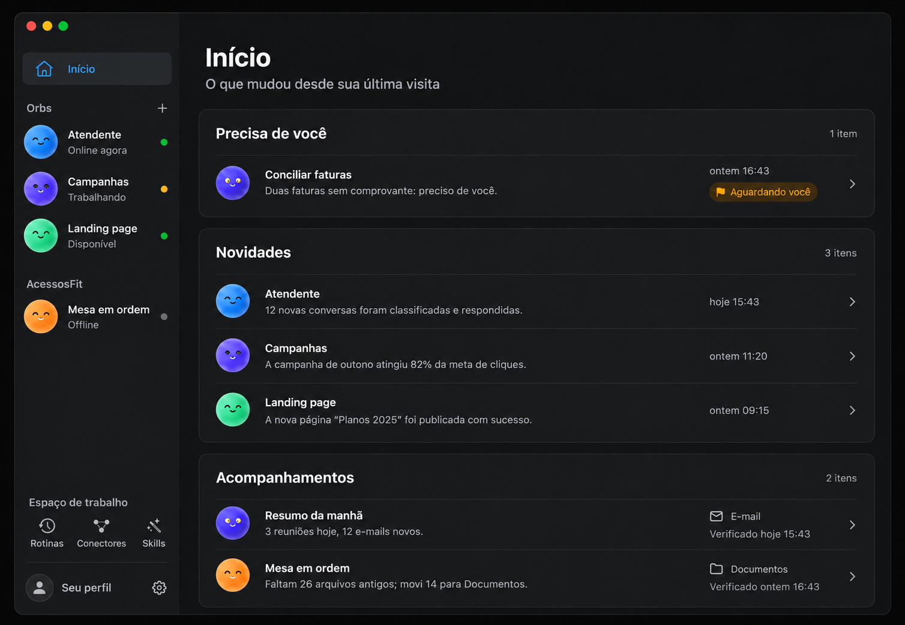
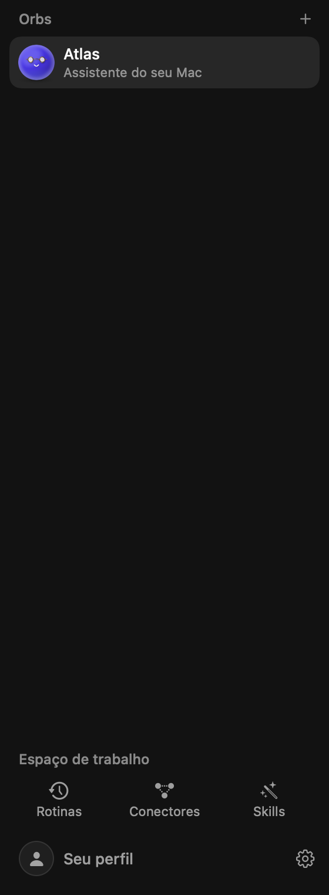
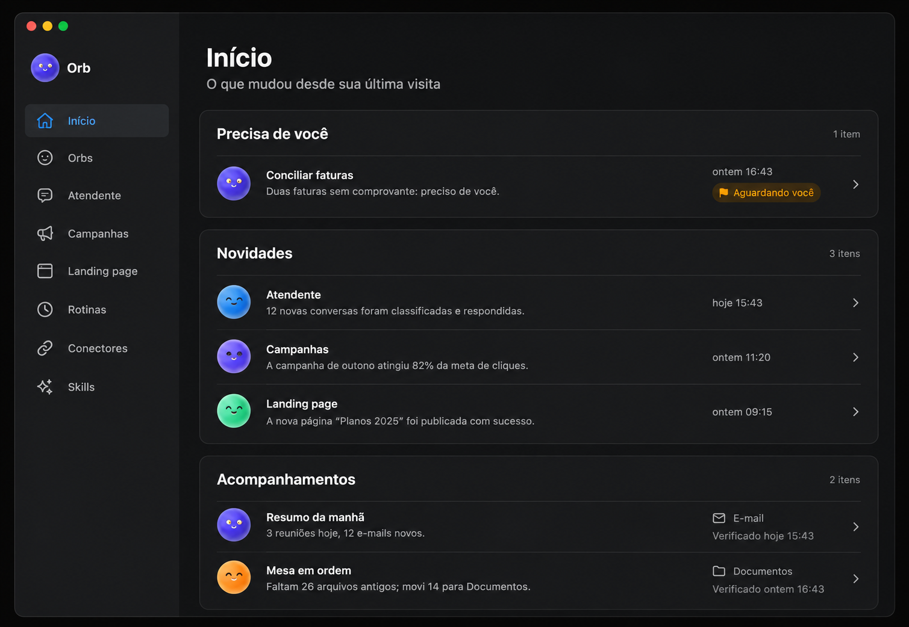
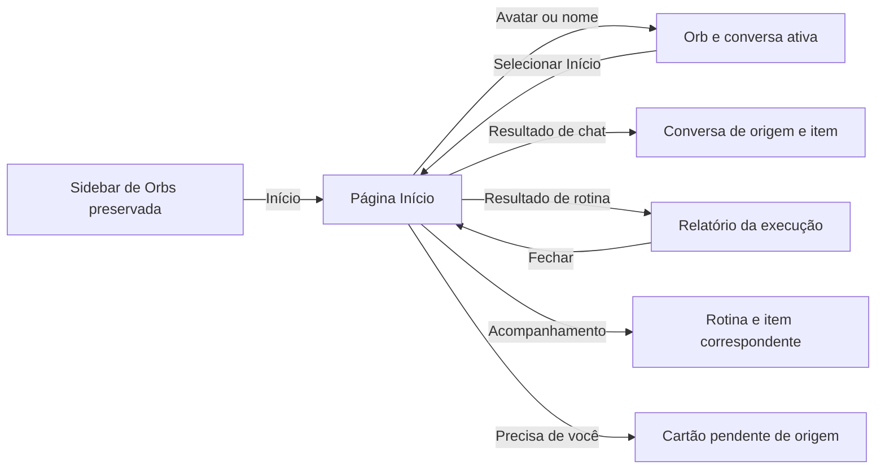

# Plano da página Início do Orb

Estado: **implementação concluída e publicada no app do Dock; validação dentro do recorte das suítes filtradas**. Data do plano: 29/10/2026; última rodada registrada: 30/10/2026. Pendentes declarados: a suíte completa (disputa foco com o app aberto) e uma sessão com VoiceOver ligado. Esta especificação orienta a implementação; o código atual continua sendo a fonte de verdade. Antes de cada etapa, revalidar o checkout, `AGENTS.md`, `CLAUDE.md`, as alterações locais e os caminhos citados. Não substituir nem reverter o trabalho existente, inclusive as mudanças feitas pelo Devin.

## Objetivo e resultado esperado

Criar uma página nativa **Início** que permita entender o que os Orbs fizeram, o que está em andamento e o que exige atenção, e entrar na conversa ou no resultado certo com um clique. Ela é uma porta de entrada para os Orbs: não substitui os chats, os painéis, as rotinas ou a sidebar.

Ao abrir o app, o comportamento existente permanece como padrão. Atualmente o primeiro Orb na ordem da sidebar é selecionado, com sua conversa ativa restaurada; não pressupor que o app já seleciona o último Orb visitado. A abertura automática de Início é uma possibilidade posterior, fora do primeiro incremento. A pessoa abre Início por uma linha discreta na sidebar, acima de “Orbs”. Se não houver Orbs, a experiência de boas-vindas deve continuar acessível e não se tornar um beco sem saída.

**Fora do escopo:** fichas/dossiês de clientes (descartados pelo usuário), busca global, reformulação geral da sidebar, métricas ou gráficos de campanha, nova agenda, alterações em prompts, execução de ferramentas, conectores, permissões, persistência de memória ou no comportamento das rotinas. Início não dispara chamadas a modelos nem acessa serviços por conta própria. Nenhuma contagem de negócio é deduzida ou inventada a partir de texto livre.

## Referência visual e limites do mockup

### Proposta refinada: Início com os Orbs na sidebar



- [Abrir o mockup refinado em tamanho original](mocks/inicio/sidebar-preservada.png).
- Referência visual gerada; conteúdo, nomes, datas, contagens e estados da imagem são fictícios. A imagem não comprova comportamento nem reprodução exata da sidebar atual.

### Sidebar atual: referência da estrutura a preservar



Este snapshot foi gerado pelo modo `--snapshot sidebar`, com dados isolados. Mostra uma configuração simples com um Orb; não substitui os cenários de categorias, várias conversas, arrastar, trabalho em andamento e outros estados exigidos na comparação visual.

### Primeiro conceito: referência apenas da área principal



- [Mockup refinado com a sidebar de Orbs preservada](mocks/inicio/sidebar-preservada.png): direção visual pretendida, sujeita à validação da implementação.
- [Conceito inicial](mocks/inicio/conceito-inicial.png): referência para composição da área principal. **Não copiar a sidebar desta imagem**: ela foi simplificada como um menu genérico e não representa o produto.
- As duas imagens são geradas, estáticas e usam exemplos fictícios. São referências de clima, densidade e hierarquia, não especificações exatas de texto, ícones, dados, proporções ou estados. Em particular, os pontos de presença e os rótulos “Online agora” e “Offline” da segunda imagem são inventados e não devem ser acrescentados como se fossem estados reais. Avatares reais, `Palette`, `Typography`, espaçamentos e componentes do projeto têm precedência.
- Reproduzir o comportamento e a estrutura reais da sidebar, incluindo categorias, arrastar, conversas, expansão, não lidos, estados e rodapé. Nenhuma substituição dos avatares por ícones genéricos. A referência visual deve ser confrontada com capturas da sidebar **real**, não copiada cegamente.

## Experiência funcional

### A página

Ordenar por relevância de ação, com títulos e estados sinceros:

1. **Precisa de você:** apenas perguntas/aprovações efetivamente pendentes ou resultados que já foram classificados como atenção; identificar o motivo e o Orb. Atenção de uma rotina encerrada deve ser identificada como resultado, não como pergunta ainda aberta. `BotLive.needsYou` acompanha `isAwaitingApproval`; não presumir que ele, sozinho, represente toda pergunta, todo aviso ou decisão comercial. Levantar a fonte real de cada cartão pendente antes de definir o tipo e cobrir o ciclo de resolução com testes.
2. **Em andamento:** Orbs realmente trabalhando, com nome, avatar e `shownWork`/estado vigente; não copiar texto de streaming por token. Mostrar apenas quando houver atividade. Clicar abre a conversa de trabalho apropriada; se for rotina, abrir sua execução em andamento, sem mudar o trabalho.
3. **Novidades:** resultados produzidos pelos Orbs e rotinas, com nome, data, uma frase baseada no resultado real e acesso à origem. Apresentar resultados como resultados, não afirmar automaticamente que são mudanças significativas. Começar com lista curta e “Ver mais” para preservar densidade. Falhas e resultados interrompidos não podem aparecer como sucesso; pré-checagens que dispensaram execução também devem ser distinguidas.
4. **Acompanhamentos:** itens abertos das rotinas, usando `Routine.followUps`, assunto, canal, próximo passo e `lastChecked` somente quando existentes. Ausência de data significa “ainda sem verificação registrada”, não que o Orb verificou agora. A lista depende de o agente registrar os itens e não é inventário garantido de todos os clientes.

Não exibir exemplos, totais fictícios ou seções artificialmente preenchidas em produção. Tratar dados ausentes, lista vazia, carregamento, erro, origem apagada, primeira visita, mudança de fuso/dia e conteúdo extenso. Quando não houver novidade desde o marco, informar isso e permitir consultar os resultados recentes, sem esconder pendências em aberto. Os textos são em português do Brasil.

### Ações e navegação

- Clique no **avatar/nome do Orb**: seleciona o Orb e abre sua conversa ativa, com compositor e painel disponíveis; funciona também se ele estiver trabalhando em outro chat.
- Clique no **resultado de conversa**: abre o Orb, a conversa de origem e, quando houver identificador válido, posiciona na mensagem/resultado. Não abrir outra conversa silenciosamente. Preservar rascunhos, a conversa em trabalho, itens abertos, scroll do usuário e a fila de mensagens.
- Clique no **resultado de rotina**: abrir o relatório daquele `routineID` e `runID`; se ainda estiver rodando, abrir a conversa ao vivo da rotina. O `RoutineRunSheet` atual é privado à página de rotinas; extrair/reutilizar a apresentação com roteamento no nível correto, mantendo os caminhos existentes. Se a execução tiver sido removida do histórico, oferecer a conversa da rotina se ainda existir; se não, explicar a indisponibilidade, sem abrir um item diferente.
- Clique em um **acompanhamento**: localizar o item na rotina proprietária, sem fingir que `source` sempre é um link válido. Abrir a origem externa apenas se ela existir e for um destino válido; caso contrário, abrir a rotina e mostrar os dados disponíveis. A navegação e o texto do destino devem ser explícitos.
- Uma linha não deve conter botões aninhados. Usar alvos separados para avatar/nome e detalhe, acessíveis por teclado e VoiceOver. Abrir Início por si só **não limpa** não lidos ou aprovações; abrir a conversa aplica a semântica atual daquela conversa.
- Se o Orb, conversa, rotina ou execução desaparecer entre a renderização e o clique, validar novamente e mostrar uma mensagem ou destino alternativo claramente identificado. Nunca enviar mensagem ou iniciar um turno como consequência da navegação.

## Estado e atualização: modelo proposto

### Fontes existentes e limitações

| Informação | Fonte atual | Limite ou ressalva |
| --- | --- | --- |
| Identidade, avatar, trabalho e espera | `BotLive`, `AppModel.workingIDs`, `waitingIDs` | `needsYou` é uma visão de espera específica; não é catálogo universal de decisões. Estado em tempo real não deve ser persistido como se continuasse ativo após reinício. |
| Resultado de rotina | `Routine.runs`, `RoutineRun`, `recordRoutineRun` | Últimas 10 entradas por rotina; pré-checagem pode gerar entrada sem turno; relatório pode estar truncado ou ausente. |
| Acompanhamentos | `Routine.followUps` / `RoutineFollowUp` | Alterados pela ferramenta do agente ou pela interface; `source` é texto opcional; lista só reflete o que foi registrado. |
| Conversas | `OrbChats`, `BotSession`, `TranscriptItem`, `Store` | Primeiro chat pode não ter `OrbChats`; conversa ativa e conversa em execução podem ser diferentes; `ReplyPreview` só guarda a última resposta do Orb, sem ID da conversa/mensagem. |
| Eventos | `OrbEvent`, `appendToChat`, transcript | Um evento pode existir no chat e também no histórico de rotina; deduplicar por identidade, não por texto. |
| Perguntas/aprovações | `BotSession` / transcript / gates | Modelar o cartão vivo de origem e seu ciclo de vida; um evento histórico não prova que a pessoa ainda precisa responder. |

### Registro local de atividade

Proposta: um registro **derivado e limitado**, responsável por navegação e apresentação, nunca a fonte de verdade de conversas ou rotinas. Nome provisório `InicioEntry`/`InicioStore`; nomes e separação finais devem seguir `docs/ARQUITETURA.md` após inspeção. Cada entrada tem ID estável, tipo, instante do acontecimento, `botID`, referência tipada à origem (`chatID` e `itemID`, ou `routineID` e `runID`), resumo curto já existente, resultado/estado e versão do formato. Não armazenar prompts completos, texto de ferramentas ou cópias de conversas. A referência exata precisa ser capturada **antes** de estacionar/restaurar a sessão; `latestChat` pode não ser a conversa que produziu o resultado.

- Evento de rotina: usar `RoutineRun.id` como identidade lógica; registrar uma vez no encerramento efetivo, inclusive falha e rotina que esperou outro Orb. Não duplicar o `OrbEvent` inserido no chat. Diferenciar pré-checagem dispensada do trabalho realizado. Hoje `skippedRoutine` cria `RoutineRun` com `succeeded = true` e resumo textual; não há tipo estruturado que identifique a dispensa de forma confiável. Capturar o tipo explicitamente no ponto da pré-checagem para novos eventos; para histórico legado sem evidência inequívoca, apresentar estado desconhecido/resultado registrado, sem inferir pela frase.
- Resultado de conversa: usar IDs existentes do item de transcript e do chat que trabalhou; capturar no ponto em que o turno terminou. Não derivar a origem apenas de `ReplyPreview`, pois ele não a guarda e também pode representar rotina/pedido de outro Orb. Não adicionar streaming, revisões auxiliares ou mensagens em andamento como resultados concluídos.
- Estado de perguntas e trabalho: derivar do estado vivo existente; não gravar cartões ativos como se continuassem ativos depois de reinício. Se a origem não puder ser determinada sem alterar regras existentes, não exibir como ação navegável até existir uma rota confiável.
- Ordenação estável por data e ID; deduplicar antes de agrupar. Limitar quantidade e idade de forma explícita e testada; manter paginação simples. Não apagar a fonte ao expirar uma entrada. Acompanhar o limite e comunicar “mostrando os resultados recentes”, sem prometer histórico infinito.
- Persistência: decidir entre novo campo tolerante em `AppState` e arquivo derivado próprio apenas depois de medir volume e frequência. Se em `AppState`, atualizar inicialização e propriedade `state`/`scheduleStateSave` em `AppModel`, `Store.swift`/`AppState.init(from:)`, e `Reset/`; manter default vazio e decodificação por item tolerante. Se em arquivo, usar a fila/`FileGate` e tratamento de falhas de `Store`, sem leituras no `body`. Em ambos os casos, definir a ordem de escrita em relação à fonte, deduplicação, reconstituição limitada após falha e evitar perda silenciosa. Não executar gravações em `body`.
- Primeira instalação/versão antiga: construir apenas uma visão inicial limitada a fontes disponíveis; o histórico de dez execuções e uma última resposta não permitem reconstruir todos os eventos antigos. Marcar recorte como “recentes”, não como histórico completo. Falha de leitura preserva os dados e mostra erro; nunca sobrescreve automaticamente a fonte.

### Marco “desde sua última visita”

Não reutilizar `unread`, `OrbChats.Entry.unread` nem `Conversation.contextHandedAt`: são estados com outros significados. Salvar um marco específico de Início, com default ausente. Na primeira visita, exibir uma janela de resultados recentes claramente identificada. Em visitas seguintes, congelar o marco anterior ao entrar; os resultados desde então permanecem visíveis durante essa visita e os que chegam ao vivo entram sem apagar os anteriores. Avançar o marco de modo persistente ao sair da página ou fechar o app, preservando estabilidade se eventos chegarem na transição. O marco não marca chats como lidos. Comparar também IDs para evitar perda em eventos com horários iguais ou alteração do relógio. Cobrir ida/volta rápida, fechamento, falha de gravação, mudança de relógio e eventos simultâneos.

### Observação e desempenho

A página observa projeções pequenas: identificações, versões e mudanças por Orb; não observar texto em streaming ou `bots` inteiros para cada linha. `BotLive` publica valores separados e apenas quando mudam. A agregação deve ser cancelável e feita fora da thread principal quando incluir leitura/filtragem pesada; antes de publicar, verificar cancelamento e geração mais recente. A atualização só deve ocorrer ao mudar uma entrada ou estado relevante. Não carregar todos os chats, indexar texto ou chamar modelo ao abrir. Linhas têm IDs estáveis; limitar trabalho, usar lista preguiçosa se necessário e não reordenar continuamente enquanto a pessoa interage. Enfileirar entradas novas sem deslocar conteúdo sob o cursor; preservar posição de rolagem. Não fazer polling adicional de rede.

## Desenho e movimento

Usar `Theme.swift`, `Palette`, `Typography`, componentes de linha e `Motion.swift`; reusar `BotAvatar`/`SettlingOrb` e a pausa por visibilidade. O desenho de referência é orientação, não uma licença para importar biblioteca, fonte ou alterar identidade. Preferir blocos com hierarquia clara e espaço, sem mosaico de números vazios. Contraste e tamanhos precisam funcionar no modo claro e escuro.

- Troca para Início usa `pageSwap` existente; entrada curta e discreta, sem apresentação cinematográfica em cada visita.
- Uma novidade nova aparece com `Motion.arrive`/fade, sem reiniciar animações dos outros itens; atualização de texto não remove/recria a linha. Evitar salto de scroll.
- Ícones e avatares ativos seguem seus estados reais. Avatares decorativos em repouso usam solução existente e não mantêm relógios ativos quando fora da tela ou invisíveis.
- Hover e foco acompanham o idioma visual do app; estado de seleção claro. Em Reduzir movimento, usar `Motion.adapted`/fade ou nenhuma animação; não depender exclusivamente de cor ou movimento para comunicar estado.
- Largura de 460 pt: uma coluna, linhas com texto quebrando, sem colisão ou cortes de ações; 1100 pt: largura confortável e densidade equilibrada. Testar também largura mínima da sidebar e janela com inspector/sem inspector. Observar apenas mudança de faixa de largura, não salvar cada pixel em `@State`.

## Mapa de alterações previstas

| Área | Arquivos atuais a inspecionar / proposta | Mudança e cuidado |
| --- | --- | --- |
| Seleção | `Models.swift` (`SidebarItem`), `Views/RootView.swift`, `Views/WelcomeView.swift`, usos de `SidebarItem` | Novo caso de página e roteamento exaustivo; preservar welcome, inspector, seleção inicial e switches existentes. |
| Sidebar | `Views/SidebarView.swift`, `Views/SidebarCategoryViews.swift`, `SidebarDrop*`, snapshots e testes | Linha Início acima de Orbs, fora da área de drop; preservar namespace de seleção, safe areas, drag, categorias, rodapé e estados. Não trocar a lateral pelo desenho genérico. |
| Tela | Novo arquivo em `Views/`, extensão pequena em `AppModel+…` e modelo de projeção próprio | Tela nativa, estados completos, ações explícitas; dados e regras fora da view. Não criar abstrações além das necessárias. |
| Atividade | `BotSession+Turn.swift`, `AppModel.swift` (`recordRoutineRun`, `skippedRoutine`), `MultiOrb/OrbEvent.swift` | Capturar origem correta uma vez; preservar delegação e fechamento de rotina; não alterar o motor ou o texto do modelo. |
| Persistência | `Store.swift`, `StoreCoordination.swift`, `AppModel.swift`, `Reset/` conforme decisão | Compatibilidade, limites, falha e recuperação; registro derivado e marcador separados de unread. |
| Navegação | `AppModel+Chats.swift`, `BotSession+Conversation.swift`, `ConversationFind.swift`, `Views/ChatView.swift`, `Views/RoutinesView.swift` | Abrir chat específico com espera de carregamento/cancelamento e item estável; reaproveitar `FindJump` apenas se adequado; extrair apresentação de relatório, sem duplicar lógica. |
| Trabalho e avatares | `BotLive.swift`, `Views/LiveBotAvatar.swift`, `Orbs/OrbDriver.swift`, `Orbs/OrbAnimationView.swift` | Reusar observação, atividade e pausa por visibilidade; sem novo relógio por linha. |
| Snapshots | `OrbApp.swift`, novos exemplos em `Views/…Snapshots.swift` | Cenários isolados e dispatcher somente em debug; código de produção fora de `#if DEBUG || ORB_DEV_TOOLS`. |
| Documentação | `docs/MANUAL.md`, `docs/ARQUITETURA.md`, `docs/MOVIMENTO.md` quando aplicável | Atualizar apenas quando o comportamento tiver sido implementado e testado. |

Antes de editar, verificar `rg` por switches exaustivos de `SidebarItem`, seleção inicial, roteadores e testes existentes. Novos campos persistidos têm defaults e decodificação tolerante; verificar explicitamente os dois sentidos: abrir dados antigos e gravar/reabrir os novos.

## Fases de implementação e critérios de passagem

1. **Linha de base:** registrar `git status`, comparar os arquivos tocados com alterações locais sem revertê-las; capturar sidebar/chat/rotinas atuais e guardar evidências em pasta de build, sem dados pessoais. Confirmar seleção, fluxos e tempo de carregamento. Aprovado se as capturas são reproduzíveis e nenhuma operação toca dados reais.
2. **Modelo e navegação:** criar tipos pequenos e projeção testável; resolver fontes e rotas corretas antes de criar o visual. Cobrir fontes apagadas, chat único, vários chats e rotina em execução. Aprovado se não houver tarefa iniciada ou mudança de estado de leitura só por abrir Início.
3. **Registro e persistência:** implementar a opção escolhida com limites, migração tolerante e recuperação; definir deduplicação e ordem de gravação. Aprovado somente com testes de reinício, corrupção parcial, concorrência e reset; medir crescimento e impacto na fila de gravação.
4. **Interface e sidebar:** implementar Início em SwiftUI com dados reais e exemplos apenas nos snapshots. Preservar lateral e todas as interações. Aprovado com navegação por mouse, teclado e VoiceOver, todas as seções e estados vazios.
5. **Atualização e movimento:** integrar observação sem polling de serviço, entradas estáveis, limites de custo e Reduzir movimento. Aprovado se atualizações não mudam scroll/foco ou recriam a tela inteira, e não aumentam chamadas de modelo/rede.
6. **Comparação visual e regressão:** aplicar matriz abaixo; corrigir até a interface passar, não apenas gerar imagens. Conferir release separadamente.
7. **Documentar e atualizar o app:** só após testes, revisar manual e arquitetura. Ao final do build solicitado, executar `./scripts/bundle.sh release`, encerrar o Orb normalmente se estiver seguro, abrir `build/Orb.app`, confirmar assinatura e processo. Se houver uma rotina/tarefa/diálogo ativo, esperar sem forçar ou encerrar a entrega informando que a atualização do Dock ficou pendente; não substituir o bundle de um processo ativo.

## Matriz de testes de regressão

Usar as suítes existentes aplicáveis e testes novos com nomes por responsabilidade; os nomes exatos devem ser validados com `rg` antes do comando. Execução inicial sugerida:

```sh
ORB_SKIP_REAL_BROWSER_TESTS=1 swift test --no-parallel --filter 'Inicio|RoutineTests|RoutineGoalTests|BotSessionTests|ConversationLoadingTests|ConversationFindTests|SidebarCategory|StoreTests|InterfacePolishTests|PanelUITests'
```

Dividir em grupos se necessário e registrar os resultados reais. A suíte completa não deve disputar recursos/foco com o Orb aberto; se não rodar, dizer isso. Testes reais de browser/acessibilidade e suas flags não são automaticamente necessários para esta página.

**Projeção e dados:** ordem e desempate; resultado real versus pré-checagem/falha; deduplicação de rotina e aviso; vários eventos do mesmo Orb; resumo ausente/Unicode/texto longo; limites; evento simultâneo; estado vazio; entrada cuja origem foi apagada; ausência de alegações extraídas de texto; cancelamento de leitura antiga e resultado mais recente; não disparar modelo/rede.

**Ciclo de vida:** conversa única sem `OrbChats`; várias conversas, conversa em trabalho diferente da mostrada; rotina estaciona/restaura chat; delegação pendente; grupo; execução interrompida; Orb renomeado/apagado; tarefa mudada durante navegação; voltar para Início; não interromper tarefa, não perder anexos, rascunhos, foco, scroll ou detalhes abertos; IDs resolvidos após carregamento assíncrono; cartão de pergunta permanece acessível até respondido.

**Persistência e tempo:** estado anterior sem campos; novo formato e reabertura; elemento inválido sem perder vizinhos; falha de escrita e arquivo corrompido preservado; limite/expiração sem apagar origem; reset; primeira visita; mesma data/ordem estável; data futura e relógio alterado; marca de Início separada de unread e `contextHandedAt`; visita rápida e eventos na saída; reinício após tarefa interrompida; deduplicação depois de reconstituir.

**Sidebar e acessibilidade:** drag de Orb e categorias, grupo e estado recolhido, ações existentes, foco/seleção, unread, sidebar vazia, teclado e VoiceOver com nomes e destinos, sem botões aninhados, tamanhos de alvo e conteúdo escalado; movimento reduzido; estado claro/escuro. Verificar que Início não captura área de drop e não interfere com indicadores de outros Orbs.

**Medição:** com muitos Orbs, eventos e acompanhamentos, cronometrar abertura e atualização com e sem a página visível; contabilizar reconstruções e tarefas pendentes, leituras de disco e uso de CPU/energia. Comparar com linha de base; manter atualizações por evento e demonstrar que stream de texto não redesenha toda a página. Verificar cancelamento, retenção de sessões e pausa dos avatares fora da tela.

## Comparação visual e inspeção funcional

### Evidências da implementação em andamento

As imagens abaixo foram geradas com os modos de snapshot de desenvolvimento e dados fictícios, sem usar as conversas reais. A primeira deve ser comparada com o mock refinado e com a sidebar anterior; as demais mostram estados e largura estreita. O projeto usa uma paleta escura fixa, inclusive quando o sistema prefere aparência clara.

- [Início com a sidebar real, 1100 pt](evidencias/inicio/sidebar-1100.png)
- [Resultado que pede atenção, 460 pt](evidencias/inicio/atencao-460.png)
- [Sem Orbs, 460 pt](evidencias/inicio/vazio-460.png)
- [Orb trabalhando, 1100 pt](evidencias/inicio/trabalho-1100.png)
- [Textos longos e muitas novidades, 460 pt](evidencias/inicio/texto-longo-460.png)

A comparação visual levou à inclusão de contagens, separadores no cabeçalho dos cartões e centralização do estado vazio. Em uma prévia interativa isolada, foram conferidos nome do Orb → conversa, resultado → mensagem de origem, resultado de rotina → relatório, acompanhamento → rotina e retorno aos resultados recentes. Com a página rolada, uma entrada simulada preservou a posição e apareceu ao clicar em “Novos resultados”; ao sair sem apresentá-la, apareceu como novidade na visita seguinte. As capturas são estáticas: não comprovam movimento, foco por teclado, VoiceOver ou recuperação após falha de gravação. Esses critérios continuam exigindo verificação própria.

**Registro de validação:** os testes filtrados mais recentes passaram com 187 testes, incluindo reinício após escrita parcial, conversa que não pode ser gravada, deduplicação, origem removida, reset, chat e rotinas; uma execução anterior mais ampla passou com 238 testes. As suítes de movimento e avatares passaram com 93 testes. Uma rajada sintética de 510 gravações do registro preservou as 500 entradas finais na ordem esperada em cerca de 1,1 s no teste. Foi acrescentado um registro de recuperação limitado, gravado depois da conversa quando se trata de resultado de chat. O estado principal continua autoritativo para o marcador de visita; entradas anteriores à sequência já gravada não são recriadas. A recuperação de execução de rotina exige que a execução já exista no estado salvo, e não há como recuperar dados que nunca chegaram ao disco. O release com essa recuperação foi compilado, assinado com a identidade local e reaberto de `build/Orb.app` após confirmar que os Orbs estavam parados. A suíte completa, VoiceOver e redução de movimento em execução permanecem por validar.

**Medição pontual:** em debug, com dados fictícios e espera de dois segundos, capturar Início com muitos resultados a 1100 pt consumiu aproximadamente 1,14 s de CPU de usuário e teve pico de memória residente de 197 MiB; a captura de Rotinas nas mesmas condições consumiu 1,21 s e teve pico de 231 MiB. São processos inteiros de snapshot, incluindo inicialização: não isolam o custo da página nem demonstram desempenho contínuo, e não são uma comparação controlada de animação ou rede.

**Navegação concorrente:** uma bateria posterior passou com 210 testes. Um teste mantém um turno ativo, inicia a leitura de outra conversa a partir de Início e apaga essa conversa antes de a leitura terminar: o turno continua e a interface recebe o aviso de origem indisponível. Uma rota de Início também é recusada enquanto o reset estiver em andamento.

**Foco e reset:** outra bateria passou com 211 testes e incluiu um reset iniciado durante a leitura de uma origem. Na prévia isolada, fechar um acompanhamento e fechar um relatório devolveram o foco às respectivas linhas; Espaço e Enter reabriram o acompanhamento focado. A navegação por teclado também alcançou o avatar e o nome do Orb, e ambos abriram sua conversa. As capturas de 460 e 1100 pt foram repetidas depois desse ajuste. Essa inspeção de teclado e da árvore de acessibilidade não substitui uma sessão com VoiceOver ligado. Os 107 testes focados em grupos, delegação e categorias da sidebar também passaram.

**Rodada de 30/10/2026:** o modo `inicio-reduced-motion` foi acrescentado ao dispatcher (a `InicioView` ganhou `reduceMotionOverride`, já que `accessibilityReduceMotion` é um ambiente somente leitura); a captura estática fica idêntica à normal, como esperado, e exercita o caminho `Motion.adapted` com redução — a diferença real de animação segue coberta pelas suítes de movimento. As 16 capturas dos oito modos a 460 e 1100 pt foram geradas em `build/evidencias/inicio/` e inspecionadas: hierarquia, contagens, “Ver mais”, truncamento em três linhas, estado vazio centralizado, atenção apresentada como resultado e sidebar real preservada com a linha Início selecionada. A bateria filtrada passou com 299 testes em 25 suítes (Início, rotinas, sessão, conversas, sidebar, Store, polimento e painel). Debug e release compilaram; o release foi empacotado por `scripts/bundle.sh`, assinado com “Orb Local”, e `build/Orb.app` foi reaberto após encerramento normal do processo anterior, que estava sem gravações havia mais de uma hora. Permanecem declarados como não executados: a suíte completa (disputa foco com o app aberto) e uma sessão com VoiceOver ligado (a árvore de acessibilidade e o foco por teclado foram inspecionados na prévia isolada).

**Revisão e suíte completa, 30/10/2026:** todos os diffs do projeto foram revistos sob re-renderização, gargalos e casos de borda. A dobragem do transcript (`rows`) é calculada uma vez por mudança de `items` e o avatar pausa quando ocioso; aprovações, perguntas e propostas pendentes nunca entram no bloco `.activity` (`joinsToolRun` exige decisão). Encontrado e corrigido um caso de borda: se a conversa estivesse ausente no `beginTurn`, o marco do turno virava zero e uma resposta antiga podia ser gravada como resultado novo — o marco passou a ser opcional e a gravação só acontece com fronteira conhecida. A suíte completa rodou com 4.964 testes em 531 suítes (~205 s): uma falha real, o teto de caracteres dos specs de ferramentas estourado pelo `precheck` do `schedule` (19.520 medidos); o teto foi elevado para 19.600 com nota medida, como a convenção do teste, e a bateria de economia voltou a passar. As outras duas issues são registros intencionais de `withKnownIssue` em `WaitingTests`. Permanece declarada como não executada apenas a sessão com VoiceOver ligado.

1. Capturar **antes** a sidebar real, o chat e a página de rotinas existentes; depois capturar os mesmos cenários, com o mesmo seed, modo de cor, tamanho e hora controlada quando possível. Não usar dados reais ou uma pasta de produção.
2. Adicionar snapshots dedicados para `inicio`, `inicio-empty`, `inicio-working`, `inicio-attention`, `inicio-long`, `inicio-many`, `inicio-reduced-motion` e uma composição com sidebar real; validar nomes no dispatcher. Fornecer dados fictícios coerentes, com origens válidas e casos de erro.
3. Renderizar cada cenário necessário a **460 e 1100 pt** e, para a sidebar, sua largura mínima; incluir modo claro/escuro. Exemplos depois de implementar os modos:

```sh
ORB_SNAPSHOT_WIDTH=460 ORB_SNAPSHOT_WAIT=1.5 .build/debug/Orb --snapshot inicio /tmp/orb-inicio-460.png
ORB_SNAPSHOT_WIDTH=1100 ORB_SNAPSHOT_WAIT=1.5 .build/debug/Orb --snapshot inicio /tmp/orb-inicio-1100.png
```

4. Abrir e inspecionar as imagens, não só conferir exit code: hierarquia, densidade, quebras, alinhamento, botões, contraste, datas, estados vazios e sobreposição. Comparar primeiro com os snapshots **antes**, depois com os mockups, lembrando que os mockups são conceituais e a sidebar real é obrigatória. Registrar divergências e corrigi-las; repetir capturas após ajustes.
5. No app de desenvolvimento com dados isolados, verificar foco e clique dos dois alvos de uma linha, mudança ao vivo, pausas, scroll, janela estreita, VoiceOver e Reduzir movimento. Conferir a animação em execução; uma imagem estática não valida movimento. Não usar o ambiente real para simular clientes ou enviar mensagens.
6. Compilar debug e release. Verificar que `#if DEBUG || ORB_DEV_TOOLS` contém apenas sementes/snapshots, não lógica de produção. Registrar os testes, capturas e limitações na entrega.

## Critérios finais de aceite

- A sidebar continua sendo a lista viva dos Orbs; categorias, chats, estados, seleção e organização continuam funcionando.
- Início é opcional no uso e não muda a tela de abertura por padrão.
- Avatar/nome abre o Orb; resultado abre sua própria origem; origem indisponível tem resposta explícita.
- A página mostra somente dados existentes, com horário/origem e estado correto; não gera pesquisas, decisões ou mensagens.
- Abrir/fechar Início não marca chats como lidos nem interrompe trabalho; atualizações não roubam foco/scroll.
- Histórico e marco persistem com limites claros, defaults compatíveis, sem duplicação ou perda silenciosa; atividade em andamento é reconstruída a partir do estado vivo.
- Estados vazios, erros, alterações de largura, VoiceOver e Reduzir movimento foram verificados; layouts de 460 e 1100 pt comparados visualmente.
- Suítes afetadas aprovadas, build debug e release aprovados e app do Dock atualizado apenas após ser seguro. Suíte completa e testes externos não executados são declarados.

## Decisões antes da implementação

- O usuário autorizou iniciar a implementação após a revisão deste plano. A ordem de entrada na página, o recorte inicial do histórico e a retenção exata devem ser definidos ao implementar e comunicados no resultado, sem transformar escolhas técnicas em telas de configuração desnecessárias.
- A segunda imagem orienta a sidebar; a captura real e os comportamentos atuais prevalecem em caso de conflito. Não alterar o design de outras telas como efeito colateral.
- As outras ideias não implementadas, inclusive busca global, são trabalhos separados. A ficha de cliente foi descartada.

## Contratos da interface: cada alvo e seu resultado

A tabela é normativa para o comportamento, não um compromisso com ícones específicos. Cada linha é um controle separado; não usar `Button` dentro de outro `Button` e não tratar toda a linha como destino único quando nome/avatar e conteúdo levam a lugares diferentes. Um mesmo controle deve responder da mesma forma por mouse, Return/Espaço e VoiceOver. O texto de acessibilidade precisa identificar Orb, tipo de item, destino e estado.

| Ponto da interface | Alvo e intenção | Destino / efeito | Restrições e alternativa |
| --- | --- | --- | --- |
| Sidebar | Linha **Início** | Seleciona a página `.inicio`, sem mexer na seleção armazenada de chats | Selecionada visual e acessivelmente; não é área de drop, não cria Orb, não limpa unread. |
| Sidebar | Avatar/nome de um Orb | Mesmo comportamento atual de selecionar o Orb e mostrar sua conversa ativa | Não altera categorias, lista de conversas, tarefa em curso ou rascunho. |
| Sidebar | Categoria, chevron, item de conversa e menu do Orb | Mantêm os controles e efeitos atuais | Não anexar navegação de Início aos handlers de drag, expandir ou menu contextual. |
| Início, qualquer seção | Avatar/nome de Orb | Seleciona Orb e mostra sua conversa **ativa para visualização** | Pode não ser a conversa que trabalha em segundo plano; não forçar a de trabalho. Abrir painel só se já aberto pela escolha da pessoa. |
| Em andamento | Texto/ação “Ver trabalho” de chat | Abre o Orb e a conversa em que aquele turno está trabalhando | Identificar `workingChatID`/`conversationChat`, validar IDs após carregamento; não mandar texto nem mover trabalho. |
| Em andamento | Texto/ação de rotina | Abre a conversa da execução corrente, ao vivo | Resolver a identidade da rotina e `sideKind`; não assumir que todo `routineID` é rotina. Se a execução acabou no intervalo, abrir o relatório correto ou avisar. |
| Em andamento | Pedido delegado/grupo | Abrir a origem correta se existir uma rota testada | Não exibir um link para chat ou rotina errada; em caso sem rota, apresentar estado sem ação e não fingir que é rotina. |
| Precisa de você | Pergunta ou aprovação ativa | Abrir a conversa e posicionar no cartão ainda pendente | Abrir não responde nem aprova; validar se já foi resolvida, retirada ou interrompida antes da navegação. |
| Precisa de você | Resultado de rotina com atenção | Abrir o relatório correspondente | Identificar como resultado de atenção, não como pergunta ativa; se a origem sumiu, explicar. |
| Novidades | Corpo da linha de resposta | Abrir Orb e chat de origem; localizar o `itemID` quando disponível | Nunca substituir a origem pelo `latestChat` sem avisar. Sem `itemID`, abrir o chat identificado e dizer que o ponto exato não está disponível. |
| Novidades | Corpo da linha de rotina | Abrir relatório da execução `routineID` + `runID` | Distinguir sucesso, falha, interrupção e dispensada; se sumiu, oferecer conversa da rotina ou avisar, sem abrir outra execução. |
| Acompanhamentos | Corpo de um item | Abrir rotina e localizar a linha `followUpID` | A origem externa só será aberta por controle específico e destino validado; não inferir URL a partir de texto arbitrário. |
| Acompanhamentos | Ação “Ver origem”, quando houver | Abrir a origem identificada | Não mostrar botão quando a origem for inválida ou ausente; não permitir que um clique ambíguo execute a ação. |
| Lista de novidades | “Ver mais” / “Mostrar menos” | Expandir/recolher resultados carregados, sem trocar de página | Preservar foco e posição; a paginação só expõe a janela retida, não promete histórico completo. |
| Bloco com erro de leitura | “Tentar novamente” | Reexecutar apenas a leitura local falhada | Cancelar tentativa anterior, não consultar o modelo, não limpar dados ou restaurar por cima de arquivo inválido. |
| Detalhe de relatório de rotina | Copiar / Abrir arquivo / Ver conversa / Rodar de novo / Fechar | Preservar o comportamento do `RoutineRunSheet` existente | “Rodar de novo” só no detalhe já existente e como ação explícita; abrir o detalhe nunca roda novamente. |
| Janela/toolbar | Controles atuais de chat, sidebar, painel e ajustes | Permanecem com sua semântica atual | Não vincular “Início” aos atalhos existentes nem criar atalho novo como exigência desta mudança. |

### Roteador: estados e garantias

Definir um único coordenador de navegação no modelo/roteamento, em vez de closures espalhadas nas views. O tipo abaixo é **esquema proposto**, não código existente:

```swift
// Exemplos de intenção; nomes finais respeitam as APIs do projeto.
enum InicioDestination: Equatable, Sendable {
    case orb(botID: UUID)
    case chatItem(botID: UUID, chatID: UUID, itemID: UUID?)
    case routineRun(botID: UUID, routineID: UUID, runID: UUID)
    case routineLive(botID: UUID, routineID: UUID)
    case followUp(botID: UUID, routineID: UUID, followUpID: UUID)
    case waitingCard(botID: UUID, chatID: UUID, itemID: UUID)
}
```

**Contrato comum de abertura:** (1) receber e congelar a intenção e um token único; (2) validar existência e propriedade do Orb e do destino; (3) selecionar o contexto correto sem enviar mensagem; (4) quando o destino exige leitura, aguardar o caminho assíncrono existente e conferir token, cancelamento e existência novamente; (5) apenas então revelar item/abrir folha; (6) finalizar uma única vez com sucesso, indisponível ou cancelado. Um clique posterior invalida o anterior. Trocar de página, apagar o item ou cancelar não pode fazer uma leitura atrasada abrir algo inesperado.

**Abrir conversa:** `AppModel.openChat(_:of:)` exige `live(botID).chats` e um ID cadastrado; o primeiro e único chat pode existir sem essa lista. A implementação precisa de caminho explícito para esse caso. Um Orb pode manter `workingChatID`, `chatID`, `conversationChat` e `parkedChat` diferentes; não modificar essas propriedades diretamente pela view. Usar os métodos de sessão existentes, respeitando carregamento, turno estacionado e fila. `ConversationFind.reveal(quoteOf:words:)` é a implementação atual de salto por citação; **não chamar com texto inventado para navegar**: avaliar extensão de salto por item sem consulta, preservando agrupamento, flash, scroll e `pausesFollowing`.

**Abrir rotina:** a folha atual é `private`, e o histórico só retém dez execuções; adaptar a rota e a visibilidade necessárias sem clonar a view ou alterar os botões existentes. Quando o resultado for uma pré-checagem dispensada, a eventual ausência de transcript daquela execução é esperada. Uma rotina esperando delegação não deve ser apresentada como concluída enquanto o fechamento estiver suspenso. Ao abrir um item não encontrado, não usar `runs.first` como substituto.

**Leitura não significa resposta:** visitar Início preserva `BotLive.unread`, `OrbChats.Entry.unread` e cartões. Uma navegação explícita para o chat segue as regras já existentes de seleção e leitura; não marcar um Orb inteiro como lido apenas porque um relatório ou a home ficou visível. Definir e testar o retorno de Início após fechar folha, sem selecionar involuntariamente outro Orb.

### Fluxos completos para revisão



1. **Primeira visita:** selecionar Início → inicializar fontes já existentes e recentes, fora do `body` → exibir “Resultados recentes” com janela limitada ou estado vazio → nenhum marco anterior é inventado → ao sair, registrar o marco de forma segura.
2. **Retorno e nova execução:** entrar com marco anterior congelado → exibir resultados recebidos desde esse marco e pendências existentes → uma execução encerra → a linha de resultado entra uma vez, com ID e estado reais → a ordem/scroll sob o usuário permanecem estáveis → sair atualiza o marco sem mudar unread do chat.
3. **Tarefa em outra conversa:** Início mostra Orb trabalhando → “Ver trabalho” congela o ID do chat realmente em trabalho → seleciona Orb e pede abertura por API existente → após leitura e validação mostra a origem sem interromper o turno; clicar no avatar, em vez disso, mostra a conversa ativa que a pessoa estava vendo.
4. **Resultado removido durante clique:** a lista ainda contém a projeção → o usuário clica → validação percebe que a origem deixou de existir → Início apresenta informação de indisponibilidade e, quando existir, um caminho alternativo nomeado; não encaminha para outro resultado como se fosse o mesmo.
5. **Pergunta respondida enquanto a tela está aberta:** projeção viva recebe a mudança do gate/cartão → a linha deixa de estar pendente sem encerrar, aprovar ou enviar nada → uma navegação já em curso é revalidada; se o cartão foi resolvido, a pessoa recebe explicação e pode abrir a conversa.
6. **Troca de seleção durante leitura:** clique A inicia leitura → clique B ou mudança de página invalida token A → resposta de A é descartada mesmo que chegue depois de B → somente o destino atual pode publicar seleção, scroll ou folha.
7. **Inicialização sem dados / erro:** sem Orbs, Início encaminha à experiência de boas-vindas; sem eventos, mensagens neutras; erro de leitura mostra “Não foi possível carregar” e opção de tentar novamente; não preencher vazios com exemplos nem sobrescrever um arquivo inválido.

## Esquemas de dados e invariantes de persistência

Os esquemas a seguir são um contrato para orientar a implementação e seus testes, **não arquivos que já existem**. Os nomes dos tipos e a representação `Codable` exata podem mudar para seguir o projeto; quaisquer diferenças precisam preservar invariantes e ser registradas na implementação.

### Evento persistido e origem tipada

```json
{
  "versao": 1,
  "id": "identidade-estavel-da-origem",
  "ordemLocal": 128,
  "aconteceuEm": "2026-10-29T16:45:00Z",
  "orbID": "00000000-0000-0000-0000-000000000001",
  "tipo": "rotina_finalizada",
  "resultado": "concluida",
  "resumo": "Resumo existente produzido pela execução.",
  "origem": {
    "tipo": "rotina",
    "rotinaID": "00000000-0000-0000-0000-000000000002",
    "execucaoID": "00000000-0000-0000-0000-000000000003"
  }
}
```

Representações aceitas para `origem` são mutuamente exclusivas: `chat` requer `orbID`, `chatID` e `itemID` quando disponível; `rotina` requer `orbID`, `rotinaID`, `execucaoID`; outros tipos só entram quando têm origem e rota verdadeiras. `resultado` deve distinguir pelo menos conclusão, falha/interrupção e dispensa por pré-checagem; “atenção” só quando já houver classificação explícita. O exemplo usa nomes em português apenas para leitura: a implementação poderá utilizar chaves em inglês seguindo convenções atuais. Versão desconhecida/tipo desconhecido não é interpretado como sucesso e não destrói os registros conhecidos.

| Campo | Requisito | Razão e teste |
| --- | --- | --- |
| `versao` | Inteiro conhecido, com migração/default explícito | Uma versão futura não pode corromper a anterior. |
| `id` | Determinístico para a origem, estável entre reconstituições | Mesmo `runID` visto por histórico e evento de chat produz uma linha; dois resultados distintos não colidem. |
| `ordemLocal` | Sequência monotônica atribuída por um único escritor persistente | Empates de data e ajustes do relógio não perdem novidade. Definir a atribuição na fila serial escolhida, não em tarefas concorrentes. |
| `aconteceuEm` | Instante absoluto, data de exibição convertida no Mac | Exibir hora local; não usar hora como identidade ou como única marca de leitura. |
| `orbID` | ID real de Orb existente na origem | Nome e avatar podem mudar sem quebrar navegação; ausência ao abrir leva a indisponível. |
| `tipo` / `resultado` | Enum com decodificação tolerante e sem reclassificar falha | Um estado não reconhecido não deve parecer concluído; teste de formatos antigos e futuros. |
| `resumo` | Texto delimitado já produzido, sem processamento que invente números | Cortar no limite explicitado e manter o relatório original na origem; nenhum dado fictício. |
| `origem` | União tipada de IDs que descrevem um único destino | Relatório/execução não pode ser roteado como chat por causa de um ID parecido; testar pertencimento ao Orb. |

`id` e `ordemLocal` têm papéis diferentes: `id` impede duplicatas; `ordemLocal` define o que entrou antes ou depois. Datas são apenas apresentação/ordenação secundária. A implementação deve escolher e documentar o formato estável do ID e a política de limite/expiração **antes** de gravar dados reais. Proposta inicial para medição: até 500 eventos ou 30 dias, prevalecendo o primeiro limite atingido, com preservação das fontes; se o usuário ficou ausente por mais tempo ou ocorreu descarte por limite, a tela informa que mostra apenas resultados recentes. Esses números são limites propostos para validação de desempenho, não recursos já implementados.

### Estado do marco e ciclo de visita

```json
{
  "ultimaVisitaConfirmada": { "ordemLocal": 127 },
  "versao": 1
}
```

- Campo ausente em dados anteriores significa **primeira visita**. Não usar zero como prova de que todo o histórico passado foi processado.
- A entrada em Início cria, em memória, uma sessão de visita com `marcoAnterior`, `limiteVisto` e token de geração; a sessão mostra as entradas posteriores ao marco anterior e preserva essas linhas enquanto a pessoa está nela.
- `limiteVisto` avança apenas até eventos incorporados à projeção publicada, nunca simplesmente até “agora”. Uma entrada que chega depois do snapshot final precisa continuar como novidade na visita seguinte. Empates de horário não importam para esta regra.
- Na saída, persistir o maior limite efetivamente incorporado; gravação deve ser serializada com a inserção de eventos, transacional quando compartilharem arquivo. Se o estado for dividido entre arquivos, documentar e testar a ordem e a recuperação para que um marco nunca aponte além do log gravado.
- Em gravação falha, conservar o marco anterior durável; repetição de novidades é preferível a perdê-las silenciosamente. Ao reiniciar, nunca presumir que uma visita volátil foi gravada.
- Entrar em Início não altera o marco das conversas. A revisão da semântica de eventos vistos que chegam enquanto a página está aberta deve incluir testes de entrada/saída em rápida sequência e fechamento do app.

### Projeção visível, estado vivo e limites

```swift
// Modelo conceitual; não confundir com o formato persistido.
struct InicioSnapshot {
    var pendentes: [InicioRow]       // cartões realmente pendentes e resultados de atenção distintos
    var emAndamento: [InicioRow]      // derivado de BotLive e sessões atuais
    var novidades: [InicioRow]        // eventos retidos, identificados e ordenados
    var acompanhamentos: [InicioRow]  // RoutineFollowUp aberto, por rotina
    var estado: InicioLoadState      // carregando, pronto, vazio ou erro recuperável
}
```

Cada linha tem ID de identidade lógica, título, subtítulo opcional, data opcional, `botID` e destino tipado opcional. Dados exibidos devem derivar de uma única fonte por campo. Não persistir `InicioSnapshot` como verdade, nem uma conclusão baseada em parser de linguagem natural. `emAndamento` e cartões pendentes são reconstruídos ao iniciar; não ressuscitar indicador de trabalho a partir do arquivo de eventos. Evitar que uma única mudança de texto de streaming invalide os snapshots de todos os Orbs.

**Precedência e apresentação:** pendência ativa aparece em “Precisa de você”; resultado de rotina com atenção aparece identificado como resultado, e não também em “Novidades” como linha duplicada na mesma visão. Quando a atenção cessar, manter o histórico como resultado se ele ainda existir. Acompanhamento aberto é uma entidade própria e não é prova de nova resposta. O mesmo Orb pode aparecer em mais de uma seção por motivos diferentes; deduplicar o acontecimento pelo ID da origem, não esconder pendências só por compartilharem Orb.

### Regra de armazenamento e falhas

1. A fonte existente (conversa/rotina) é autoritativa; o índice de Início é derivado e nunca regrava aquela fonte para se corrigir.
2. Uma gravação do índice que falhar não deve marcar seu evento como entregue de forma irreversível. Registrar erro pelo mecanismo existente, manter a cópia em memória enquanto possível e tentar novamente em ponto de salvamento apropriado.
3. Especificar uma recuperação delimitada usando IDs estáveis das fontes retidas; nem todo histórico é recuperável por causa do limite de dez execuções. O app deve informar ausência de dados quando não puder reconstruí-los, sem criar valores ou dizer que tudo está atualizado.
4. Escritas em `AppState` precisam passar pela fila e debounce já existentes; se outro arquivo for escolhido, seu mecanismo de serialização e descarte de dados deve ser incluído em reset e testado. Não acoplar a gravação da lista ao rendering da view.
5. Origem removida pode manter a linha derivada até a política de retenção expirar, marcada como indisponível; abrir ou apagar a origem nunca se torna efeito colateral de olhar Início.

## Requisitos de revisão por fase e evidências

| Fase | Entrada | Entregáveis verificáveis | Bloqueia avanço se… |
| --- | --- | --- | --- |
| A. Baseline | Checkout e mudanças existentes | Inventário de arquivos tocados, snapshots da sidebar/chat/rotinas, comportamento de seleção e trabalho | Não for possível separar a alteração das mudanças existentes ou o cenário visual usar dados reais. |
| B. Contratos | Modelo e rotas propostos | Tipos e tabelas de transição, testes unitários de identidade, classificação e prioridades | Uma origem não for identificável ou uma falha puder virar sucesso. |
| C. Persistência | Contratos B aprovados | Esquema final, limites, teste de versões, escrita/recuperação e marco de leitura | Pode perder dados, duplicar eventos ou marcar uma novidade além do gravado. |
| D. Navegação | IDs persistidos e rotas válidas | Testes de chat único/múltiplo, loading, cancelamento, origem removida, rotina e cartão | Um clique abrir outra origem silenciosamente ou modificar o trabalho do Orb. |
| E. Interface | Projeções e navegação testadas | Snapshots em tamanhos/estados, estados acessíveis e revisão com sidebar original | A sidebar perder comportamento, houver botões aninhados ou vazios/erros artificiais. |
| F. Ao vivo/movimento | Interface navegável | Casos de evento chegando, foco/scroll, Reduzir movimento e medições de visibilidade | Uma atualização roubar foco/scroll ou animação consumir recursos quando oculta. |
| G. Release | Fases anteriores aprovadas | Saída dos testes afetados, revisão visual antes/depois, build debug e release, bundle correto quando seguro | Houver falha não analisada, código de produção preso em DEBUG ou trabalho real em andamento que seria interrompido. |

### Casos de teste adicionais obrigatórios

- **Durabilidade:** duas gravações próximas, app fechado durante debounce, item malformado entre itens válidos, sequência recuperada após reinício, versão desconhecida, arquivo ilegível, falha de gravação e retry, limite de 500/30 dias ou limite final aprovado, retorno após ausência maior que a retenção e reset seletivo.
- **Navegação:** chat único sem `OrbChats`, conversa que fica estacionada durante rotina, conversa em trabalho que não está visível, grupo, delegação, rotina dispensada por pré-checagem, execução que sai das dez retidas, Orb removido durante carregamento, cartão resolvido durante clique e dois cliques concorrentes.
- **Marco:** nova entrada chega entre render e saída; duas entradas com mesmo horário; horário retrocede; hora de verão/fuso muda; escrita do marco falha; fechamento rápido; entrada duplicada de mesma origem; página nunca visitada; evento gerado enquanto outro Orb está selecionado.
- **Interação:** clique no avatar versus corpo da linha, ambos por teclado e VoiceOver; fechamento de folha devolve foco ao alvo correto; navegação preserva rascunho/anexo, fila e scroll; destaque `FindJump` não abre barra de busca nem usa consulta artificial.
- **Qualidade:** ausência de chamadas a LLM e conectores ao abrir/atualizar, limite de leituras e CPU, render de 460/1100 pt e sidebar mínima, idiomas com texto longo, cor clara/escura, redução de movimento, avatares fora de tela e cenários com muitas linhas.
